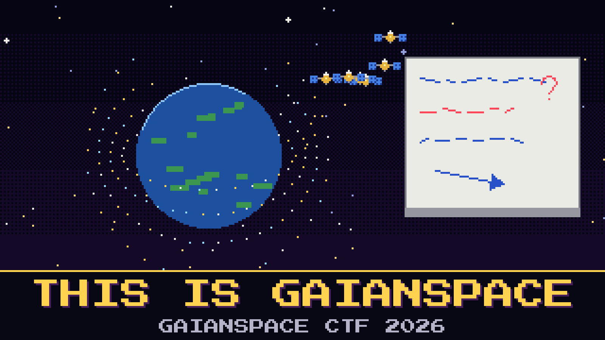

# 101-this-is-gaianspace

> Console four is live. Before the night pass, Moravec wants you to know how crowded the sky above the dish really is, and she does not want a guess.

The morning briefing to the board needs two figures: how many satellites were working in low Earth orbit in 2024, and how many the forecasts expect there by the end of the 2030s. Moravec says the house already wrote this up for the public, because GaianSpace tells the world what it is watching. She also says she has stopped trusting the whiteboard.

On the whiteboard, in someone else's handwriting: `LEO = 12,000+ ???` and an arrow to `GEO is dead anyway`. The night shift swears both came from GaianSpace pages, and they are right. Neither is what the board asked for.

Give Moravec the two figures, the 2024 count first, written as whole numbers the way the house rounds them.

**Flag format:** `GAIANSPACE{[integer],[integer]}` (for example `GAIANSPACE{100,200}`)

## Hints

- **The house talks** (cost 0): GaianSpace posts what it is watching where anyone can read it. Start with what the house has to say, not the whole internet.
- **A table, a year** (cost 1): The 2024 figure sits beside other years and other fleets. The forecast is further down, near the end of the story, and it is a round number.
