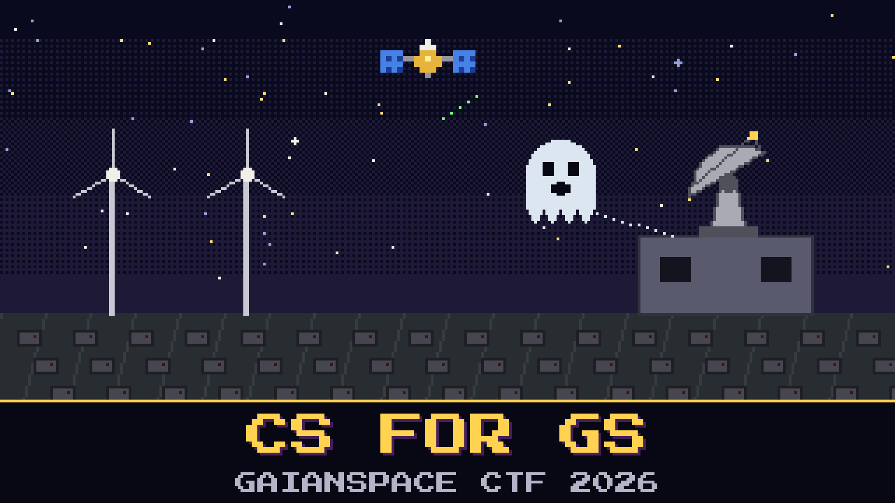

# 102-cs-for-gs

> Moravec has a rule for new hires: nobody touches a ground-station terminal until they can name the ghost that haunts every ground-station engineer.

She tells it the way it was told to her. On the morning tanks crossed a border, the satellite was never touched. Up in orbit everything was fine. Down on the ground, tens of thousands of user terminals across Europe went dark at once and never came back on their own. Wind turbines lost their remote control. A military lost its link. Someone had walked in through the ground side and left something behind that erased what it touched.

The house wrote a piece about guarding that gateway, Moravec says, and this story is in it. The old engineer at console two insists the real lesson is the Norwegian station that let someone near two American birds years earlier, and he will tell you so at length. He is not wrong about Norway. He is just answering a different question.

Name what was left behind on the ground that morning, spelled the way the house spells it.

**Flag format:** `GAIANSPACE{[Name]}`

## Hints

- **Same shelf** (cost 5): The piece Moravec means sits next to the one you read for the crowded-sky briefing.
- **The recent one** (cost 5): Among the incidents in that piece, only one is this recent and only one wiped the terminals themselves. The house puts its name in quotes.
