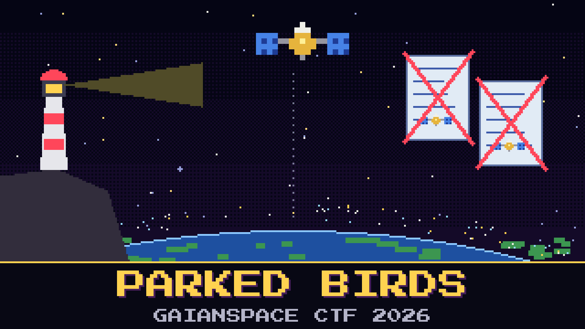

# 103-parked-birds

> Moravec finally wiped the whiteboard. One line survived the eraser because someone had circled it twice: `GEO is dead anyway`.

The board read it over her shoulder and wants proof, not a slogan. A slogan is something you write on a whiteboard, Moravec says. Evidence is money: an order someone signed and then tore up. The house wrote the long version of this argument for the public, lighthouses and all, and the proof she wants is in there. The biggest operator still parking birds over the equator bought its old rival, and then cancelled two spacecraft the rival had already ordered.

The analyst at console six is sure it was the Americas program that got scrapped. He has the right page and the wrong company. Someone else has stuck `683 / 684 ms` to the bezel of console four and calls that the proof. It is a good number. It is not an order.

Name the two birds that were cancelled, spelled the way the house spells them, in the order the house lists them.

**Flag format:** `GAIANSPACE{[Name],[Name]}`

## Hints

- **Who wrote the slogan** (cost 5): The night shift got that line from the house. The same shelf as the crowded-sky briefing holds the long version.
- **Bought, then cancelled** (cost 5): The two birds were ordered by the company that was bought, not by the one that bought it. Each one is a short name with a number. A program is not a bird.
