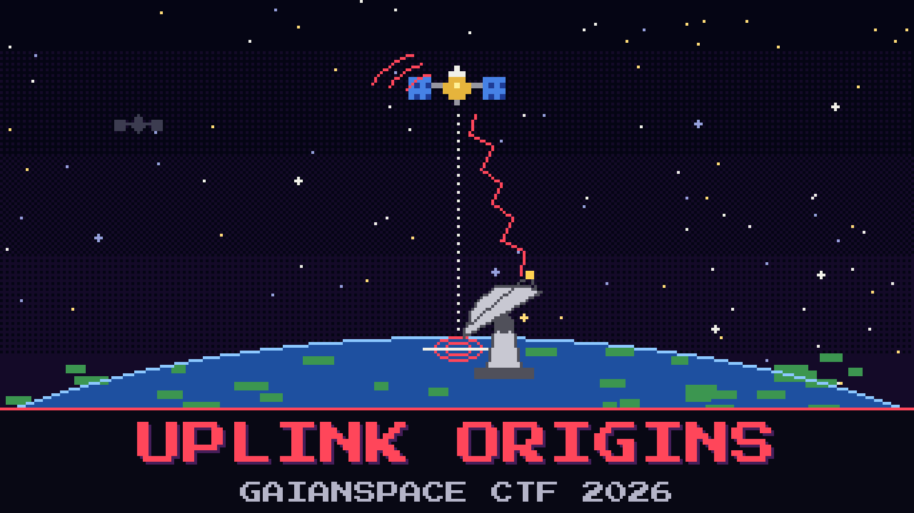

# 201-uplink-origins

> 12 June 2025, 17:15 UTC. GaianSpace Mission Control catches a command it never sent climbing up to **GAIAN-13**, our old highly-elliptical bird. Someone on the ground pointed a dish at it and talked. The watch wants to know where they were standing.

The intrusion desk has pulled the element set the flight dynamics team kept for GAIAN-13 that day and dropped it on your console. Analyst Reyes is already sure the transmitter sat under a big coastal array and will not stop saying so. What the desk actually needs is colder than a hunch: at the instant of the uplink the satellite was almost straight over the attacker, so the spot on the ground beneath it is the spot to report, together with how far up the bird was.

The log also carries a second contact on a neighbouring object from an earlier pass. It is not this event. The catalog lists GAIAN-13 as mission `EL06QL`, NORAD `00005`; ignore the nearby birds that share the plane.

Report the sub-satellite point at the uplink instant and the satellite's altitude above it.

**Flag format:** `GAIANSPACE{[Latitude],[Longitude],[Altitude]}` — degrees to two decimals, altitude in kilometres, longitude negative for west. For example `GAIANSPACE{12.34,-56.78,789.01}`.

## Files

- `gaian-13.tle` — the element set flight dynamics kept for GAIAN-13 on the day

## Hints

- **The desk is wrong** (cost 20): Reyes likes the coastal array. The ground truth is whatever the numbers say sat beneath the bird at 17:15, not where it felt right.
- **Straight down** (cost 40): When something is overhead it is directly above one point on the Earth. That point, and the height to the satellite from it, are the whole answer.
