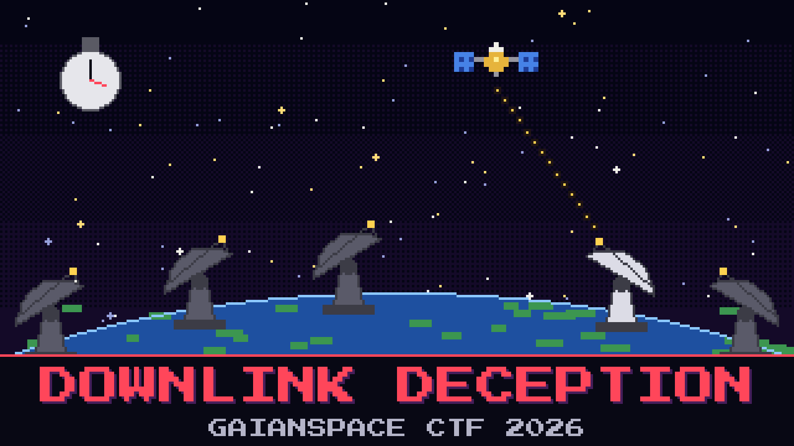

# 202-downlink-deception

> Two hours after the uplink, GAIAN-13 opened its downlink and dumped a frame it was never scheduled to send. One antenna on the ground was pointed the right way to hear it. The watch wants that antenna named, and the moment it happened.

The intrusion desk captured the frame as it came down and saved it off. Reyes is certain the big dishes caught it, because the big dishes catch everything. They did not. At the instant the frame came down the bird was only high enough over one site on the list below; the rest were looking at dirt.

Work out which site had GAIAN-13 in the clear when the frame arrived, and read the arrival time out of the capture itself.

**Flag format:** `GAIANSPACE{[callsign],[timestamp]}` — callsign exactly as the roster prints it, timestamp in the form it appears in the capture (`YYYY-MM-DDThh:mm:ssZ`). For example `GAIANSPACE{ABCD,2025-01-02T03:04:05Z}`.

Receiving-site roster (lat, lon; west is negative):

| Callsign | Operator | Latitude | Longitude |
|----------|----------|----------|-----------|
| GDSN | Deep-space net, high desert | 35.42667 | -116.89000 |
| MDSN | Deep-space net, Iberia | 40.43194 | -4.24917 |
| CDSN | Deep-space net, southern hemisphere | -35.40139 | 148.98167 |
| CAPE | Coastal array, retired | 28.53830 | -81.37920 |
| VELA | GaianSpace mid-ocean array | 19.48000 | -155.60000 |

## Files

- `telemetry_capture.bin` — the frame the desk saved off the downlink
- `gaian-13.tle` — the element set for GAIAN-13, same bird as before

## Hints

- **Dishes miss things** (cost 25): Reyes trusts the biggest antennas. Being big does not help if the satellite is below your horizon. Check who could actually see it.
- **The frame is honest** (cost 50): You do not have to guess the moment. The capture writes down when it arrived, in plain characters, near the top.
