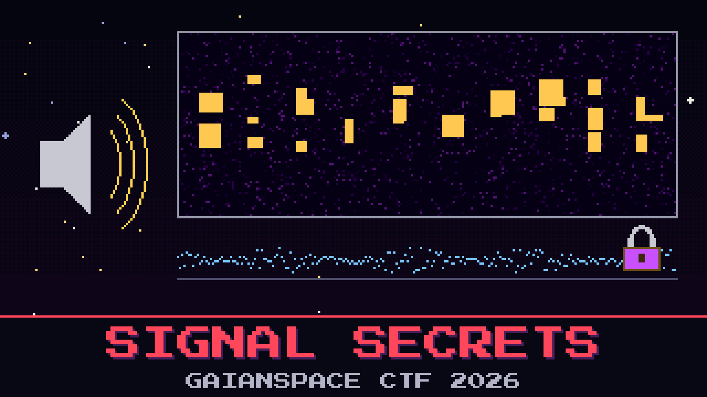

# 203-signal-secrets

> The mid-ocean array recorded the whole downlink while it was being hit. When the desk played it back, it was eighteen seconds of hiss and nothing else. The operator who caught it swears the attacker left a signature in the transmission, the way they always want the last word.

The recording is here. Reyes listened to it twice, called it dead air, and went for coffee. He heard noise because he was listening, and the one thing he did notice he threw away: there is writing in the sound if you look at it instead of playing it, but what it spells is not the answer. It is the instruction for the answer. The real message is carried under the noise floor, locked, and the writing tells you how to unlock it.

Work the recording in two passes and read the operator's parting line.

**Flag format:** `GAIANSPACE{...}`

## Files

- `downlink_signal.wav` — the array's recording of the malicious downlink

## Hints

- **Look, don't listen** (cost 30): Spread the sound out by pitch over time. Something is painted across the band. It is not the flag; it is a key, and it tells you what the key is for.
- **Under the floor** (cost 50): The flag rides in the quietest part of every sample, the part that never changes the sound. Pull that out and undo it with what the picture gave you.
