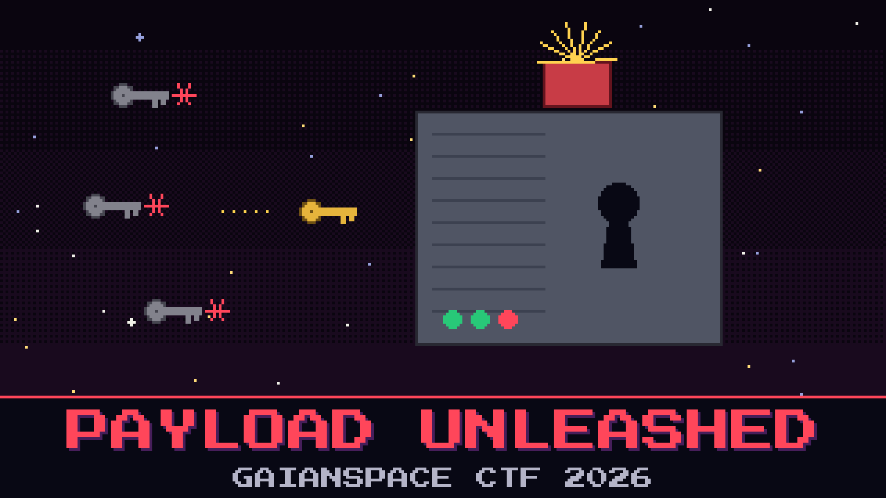

# 204-payload-unleashed

> The malicious frame did not just arrive at the array. It woke something that was already living in the decoder. The station runs an old telemetry decoder called `ground_server`, and after the frame came down the decoder started answering to a key it should never have accepted.

Forensics pulled the decoder off the array for you. It wants one argument, a key, and it throws back everything that is not the one it is waiting for. Reyes tried the mission id, the callsign, and his own initials, in that order, and got three rejections and a bad mood. Somewhere in the program is the key it actually wants and the thing it hands over when it hears it.

Make the decoder give up what the attacker armed.

**Flag format:** `GAIANSPACE{...}`

## Files

- `ground_server` — the station's telemetry decoder (Linux x86-64 ELF)

## Setup

Run it on a Linux machine: `./ground_server <key>`. It prints its usage and refuses the wrong key.

## Hints

- **It already knows** (cost 30): The decoder carries the key it is waiting for. It does not store it where a quick glance would find it. The right key is reachable without guessing.
- **Two coats of paint** (cost 50): The key is hidden under one simple operation. What it reveals is hidden under the key.
