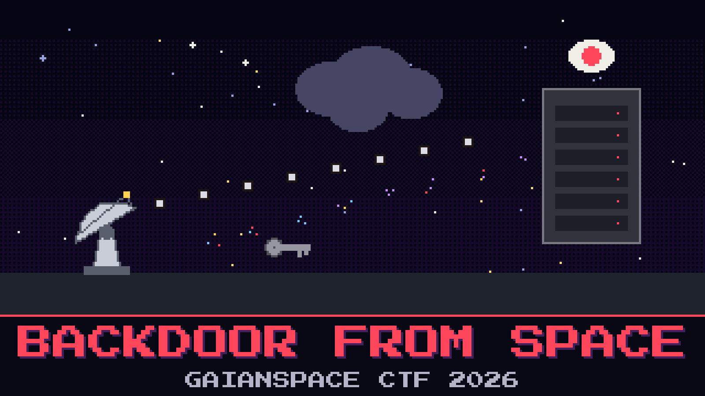

# 205-backdoor-from-space

> With the decoder armed, the array stopped being ours. For a few minutes it talked to something out on the open internet, sent it a shopping list, and got told what to do next. The span monitor caught all of it. The watch wants to know what the attacker told it to do.

This is the last of the capture. Most of it is the array doing its ordinary housekeeping; one conversation is not ordinary. The host that calls out does not call home, it calls somewhere else, and what comes back is not text and not an encoded file you can just unwrap — it is scrambled. The two sides agreed on how to scramble it earlier in the very same conversation, out in the open, if you read the whole exchange instead of only the reply. Reyes closed the case on the first familiar thing she saw. The watch log carries a training injection the array writes on purpose. The archive still hands out a park order and calls it tasking. A sync blob on a lookalike host names its own cipher and key in the headers. The range link still publishes a sample card. The encoded "nominal" block on the housekeeping link is the same kind of bait. None of that is the attacker.

Recover the attacker's next move.

**Flag format:** `GAIANSPACE{...}`

## Files

- `ground_c2_traffic.pcap` — the span monitor's capture, just after the downlink

## Hints

- **Read the whole exchange** (cost 30): The reply is scrambled with a stream cipher. The caller handed over the material for that scramble in its own request, in a header that does not belong on a normal upload.
- **Nothing labels it** (cost 50): No field tells you the cipher or the key. The reply is base64 over raw ciphertext; the key is the session value the caller sent. A common stream cipher and that value is the whole trick.
