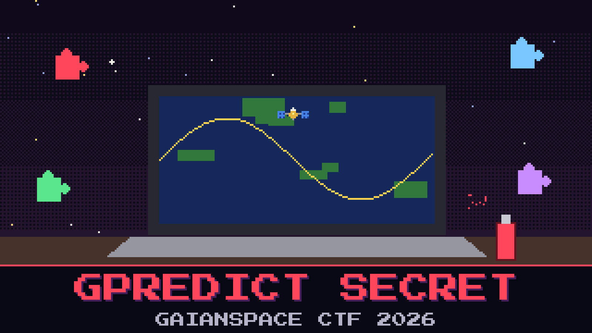

# 206-gpredict-secret

> When the attacker left GAIAN-13, they left a second element set behind on the tracking laptop, a saved tracking module, a station file, and a screen grab of a pass. Whoever set it up signed their work, the way a tagger signs a wall. The signature is not written in one place.

The flight-dynamics intern who imaged the laptop is convinced the whole thing is a copy of the operational setup and there is nothing to find. There is something to find. It is broken into pieces and scattered across what the attacker saved, and no single file gives it to you. Collect the pieces and they read like a title.

Put the signature back together.

**Flag format:** `GAIANSPACE{...}` — three fragments joined with underscores, in the order that makes them read as a phrase.

## Files

- `gaian-13-relay.tle` — the second element set left on the laptop
- `relay.mod` — the saved tracking module
- `vela.qth` — the station location file
- `pass_capture.png` — a screen grab of a pass

## Hints

- **Signed in three** (cost 20): No one file has the whole thing. One fragment rides with the object, one is noted in the saved module, one is written on the screen grab.
- **Say it out loud** (cost 40): The three fragments are not in random order. Put them together and they read like something a watcher would be called.
