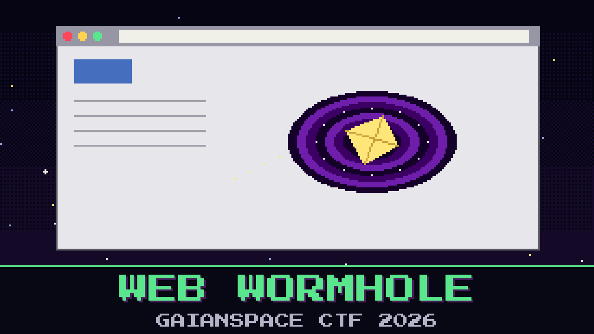

# 302-web-wormhole

> The link in that contract email did not open a contract. It opened a door. The engineer's browser went out to a "secure document portal," the portal handed back a page, the page quietly pulled down more than a page, and that is where the machine got its orders. Corporate capture had the whole exchange.

The capture holds the ordinary furniture of a web visit — a page, a stylesheet, a logo — and one thing that does not belong. The desk already skimmed the page source, found nothing but a loader, and moved on. The loader is the point. What it fetches does not read as code at a glance; it is folded up so a skim slides right past it. Unfold it.

Find what the portal actually planted.

**Flag format:** `GAIANSPACE{...}`

## Files

- `drive_by.pcap` — corporate capture of the browser visit

## Hints

- **Pull the objects** (cost 30): Reassemble the files the browser downloaded. Most are harmless decoration. One is a script that does more than decorate.
- **Folded, not written** (cost 50): Searching the capture for the answer finds nothing, because the script carries its real body folded up as text. Unfold that text and read what it sets.
