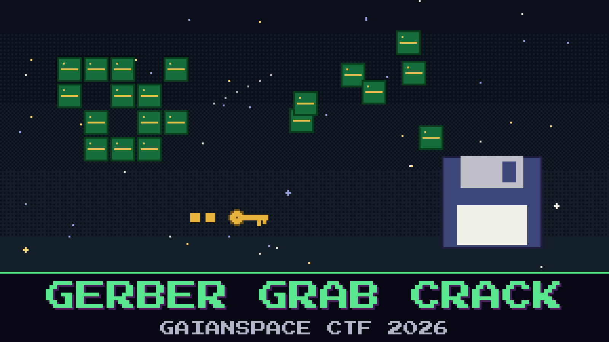

# 303-gerber-grab-crack

> The intruder did not just read the employee's drive. They packed up the Foundation One board files, scrambled them, and shipped them off the network before anyone noticed. The corporate capture caught the upload. The clean-up crew pulled a small working disk off the staging host before it was wiped.

You have the two halves: the bytes that went out the wire, and the staging disk the intruder worked from. The upload is scrambled, but the tool that scrambled it was left on the disk, and whoever wrote that tool was not careful about how it makes its key. Put the key back together, turn the upload back into the design, and the design will tell you what it is — the fabricator leaves a note on every board.

Recover the stolen board and read the fabricator's note.

**Flag format:** `GAIANSPACE{...}`

## Files

- `exfil_upload.pcap` — the corporate capture of the outbound transfer
- `attacker_disk.img` — the staging disk pulled off the host

## Hints

- **The tool tells on itself** (cost 30): The disk carries the program that scrambled the file. Read it. Its key comes straight from a phrase it keeps in the open. There is more than one job on the wire and more than one key on the disk, including one the listing does not show; an older job opens under an older phrase but is not the board you were sent, so match the key to the job before you spend your one attempt.
- **Rebuild, then open** (cost 50): The board files did not go out in one piece. Two uploads of that job carry an offset header; put the pieces together in offset order, not the order they were sent, before you undo anything. The status call afterwards gives the finished length and hash so you can check the join. Then base64-decode, decrypt with the key the tool uses, unzip, and read the note in the silkscreen file.
