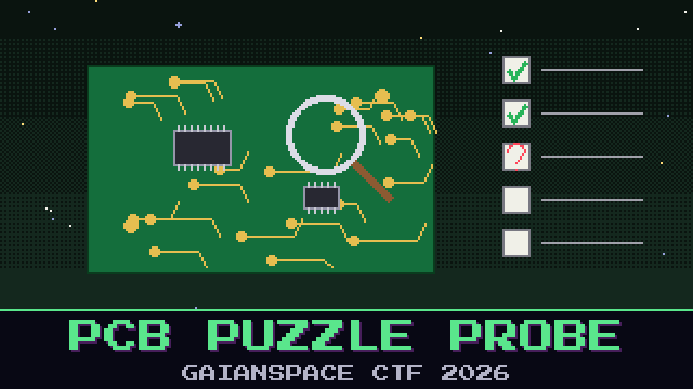

# 304-pcb-puzzle-probe



> The stolen board is back in our hands, and now the hardware team wants to know what the intruder was so interested in. The review desk will not hand over its assessment until you prove you can actually read the design. Five questions. Answer them from the board itself.

Open the Foundation One Gerber set and look at it the way a reviewer would: how it is stacked, how big it is, what is populated, and what someone left exposed that should not be. The desk checks every answer before it says a word, and it gets suspicious if you guess.

Pass the review to get its assessment.

**Flag format:** `GAIANSPACE{...}`

## Files

- `foundation_one_gerbers.zip` — the recovered Foundation One board files

## Setup

The review desk is a small TCP service you run yourself. Unzip so the folder keeps its name, then:

```
docker compose up --build
```

Connect with `nc localhost 1337` and answer each question. Read the Gerbers in any viewer (for example `gerbv`).

## Hints

- **Read, do not guess** (cost 30): Every answer is visible in the Gerber set — the layer stack, the outline, the reference designators, the labels, the pad counts. A viewer shows all of it.
- **What should not be there** (cost 40): One header on this board is wide open for anyone with a probe. Its silkscreen label names it outright.
