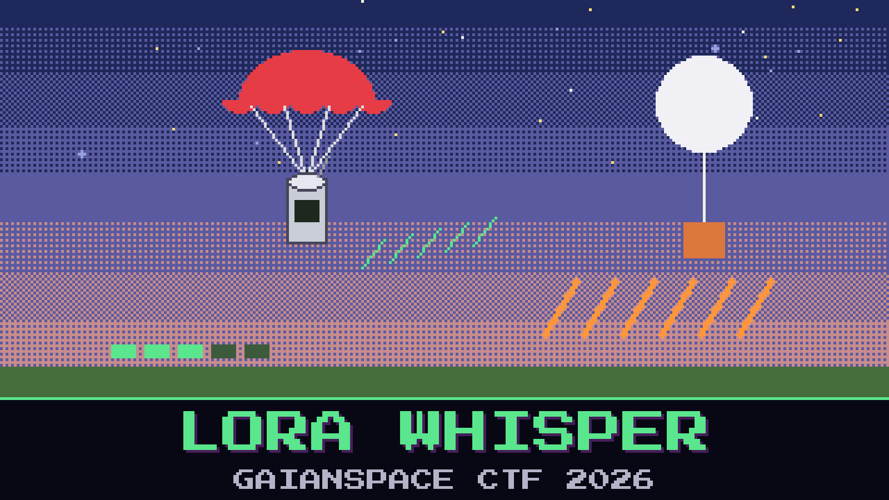

# 306-lora-whisper

> During the Foundation One descent, the ground radio sat on the CanSat band and wrote down every frame it heard. Two things were talking at once. One of them was ours, counting down something as it fell. The watch wants whatever our bird was saying, in the order it meant to say it.

The log is a plain record of received frames: who sent each one, where it sat in the sender's own count, and the bytes it carried. The bytes do not read as anything yet — they come off the modem still scrambled, the same way for every frame. The weather beacon on the next channel is louder and chattier and completely beside the point.

Reassemble what the CanSat transmitted.

**Flag format:** `GAIANSPACE{...}`

## Files

- `lora_capture.log` — the ground radio's record of the descent window
- `radio_notes.md` — the watch's notes on the receiver

## Hints

- **Pick your bird** (cost 20): Two transmitters are in the log. Only one is the CanSat. The louder, longer one is the weather beacon and leads nowhere.
- **Count, then unscramble** (cost 40): The frames did not arrive in order, but each one knows its place. Put the right node's frames back in sequence and undo the one scramble that was applied to every payload.
