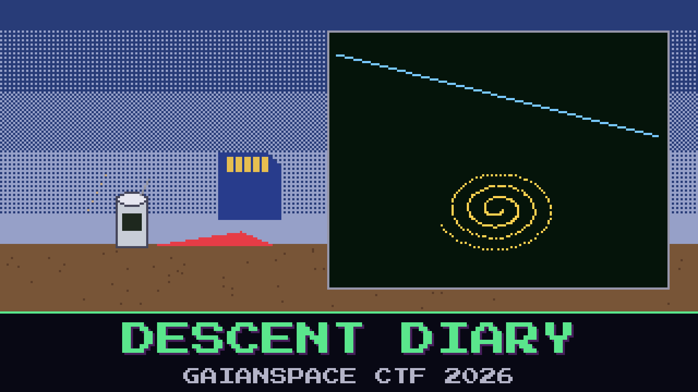

# 307-descent-diary

> Foundation One logged every sensor it had, all the way down. The recovery team pulled the card after landing and handed over the whole diary of the fall. The flight lead wants to know if the CanSat recorded anything it was not supposed to.

The barometer tells a tidy story — a clean fall from a kilometre up to a hard stop in the dirt — and that tidy story is what everyone keeps staring at. It is not where the surprise is. The CanSat carried more than one instrument, and one of them was not watching the sky at all. Let that instrument draw its own picture and it stops looking like noise.

Read what the descent diary was hiding.

**Flag format:** `GAIANSPACE{...}`

## Files

- `descent_log.csv` — the full sensor diary of the descent

## Hints

- **Not the barometer** (cost 30): The altitude curve is a distraction. Look at the sensor whose two channels mean nothing on their own.
- **Let it draw** (cost 40): Those two channels are coordinates, not a time series. Plot one against the other and stop reading them as numbers.
