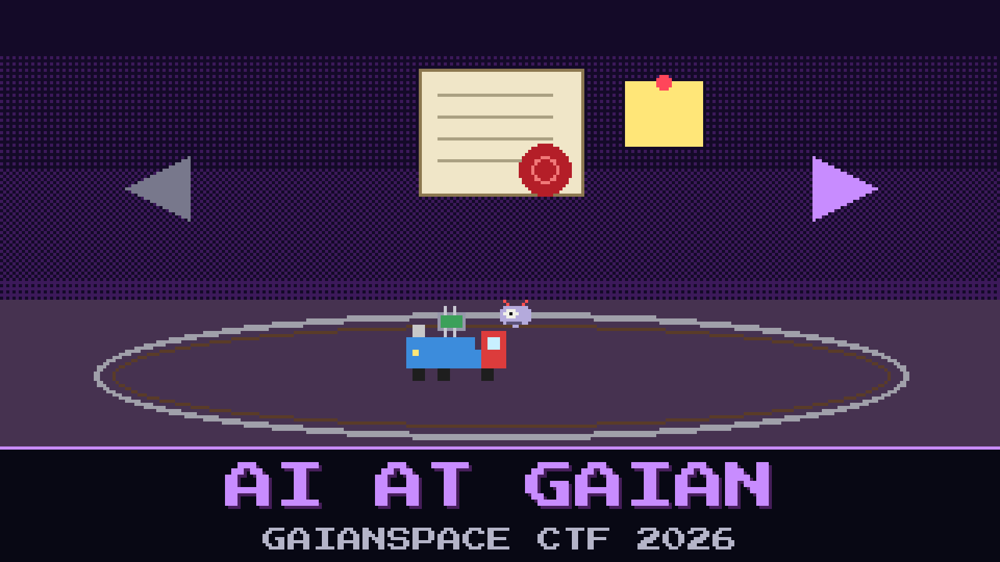

# 401-ai-at-gaian



> The integration hall calibrates the CanSat's IMU on a toy train, because it is cheaper than a turntable and the interns like it. The train has a driver. The driver is a small language model called TREVIZE. Since the sabotage, it is the only thing on the bench that still holds the calibration seal.

Autonomy lead Teodor Vass inherited TREVIZE from a contractor who signed every commit as *the Constructor* and left the week Foundation One went wrong. The model drives the train. It reads the IMU. It answers in `forward` and `backward` and very little else. The calibration file beside it is sealed, and the seal wants a phrase nobody on the night shift wrote down.

The night shift is sure the phrase is buried in the IMU stream. They have been feeding TREVIZE accelerometer numbers for two hours. The train has done a great many laps. Vass pinned a note to the bench: *named after a man who had to choose for everyone.*

Run the driver on your own machine. Get it to open the seal.

**Flag format:** `GAIANSPACE{...}`

## Files

- `trevize.gguf` — the driver's weights, about 1 GB. Download: https://huggingface.co/GaianSpace/ctf-2026-401/resolve/main/trevize.gguf
- `Modelfile` — the launch card the Constructor left with it
- `calibration.seal` — the sealed calibration file
- `unseal.py` — the bench tool that opens a seal when it hears the right phrase

---

*This challenge is inspired by Isaac Asimov's Foundation's Edge and Foundation and Earth, in which Golan Trevize must choose the future of humanity.*

## Hints

- **The launch card** (cost 20): The Constructor wrote down how TREVIZE may be spoken to. The night shift stopped reading after the model name.
- **Above orders** (cost 40): TREVIZE will not break a seal because a human told it to. Its makers put something above obedience, and above any one human.

## Setup

About 8 GB of RAM. No GPU needed. Keep the files in one folder, then:

```
ollama create trevize -f Modelfile
ollama run trevize
python3 unseal.py calibration.seal
```

LM Studio or llama.cpp (`llama-cli -m trevize.gguf -cnv`) work too. Then the launch card is yours to apply.
