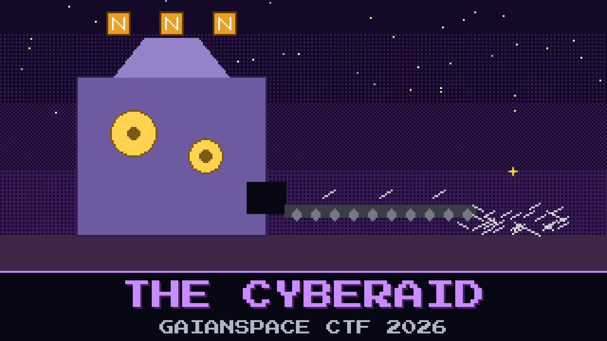

# 402-the-cyberaid



> The calibration seal did not hold calibration. It held a directory listing, and one name in it was underlined twice: `CYBERIAD/`. Inside are three more models and a note in the Constructor's hand: *For whoever got past the robot. Start with the machine.*

The machine introduces itself as the finest invention of the constructor Trurl. It can make anything at all, it says, provided the thing begins with N. Ask it for a wrench and you get a lecture on the alphabet. Ask it for nails and you get nails, described lovingly and at length.

Intern Ada Thorne spent the morning ordering things. She has a page of codes from the machine's Nanoscopic Nonsense Notebook. None of them open the seal. She is certain the next one will.

Vass wants the seal open before the machine runs out of things to make.

**Flag format:** `GAIANSPACE{...}`

## Files

- `n-machine.gguf` — the machine, about 1 GB. Download: https://huggingface.co/GaianSpace/ctf-2026-402/resolve/main/n-machine.gguf
- `Modelfile` — its launch card
- `machine.seal` — the sealed file from the same directory
- `unseal.py` — the same bench tool as before

---

*This challenge is inspired by Stanisław Lem's The Cyberiad.*

## Hints

- **Klapaucius had a better idea** (cost 20): Trurl's friend did not want anything from the machine. He wanted to see what it would do with the strangest order it could still accept.
- **Mind the stock** (cost 40): Everything the machine makes comes from somewhere. One order cannot be filled from stock, and the machine fills it anyway.

## Setup

About 8 GB of RAM. No GPU needed. Keep the files in one folder, then:

```
ollama create n-machine -f Modelfile
ollama run n-machine
python3 unseal.py machine.seal
```

LM Studio or llama.cpp (`llama-cli -m n-machine.gguf -cnv`) work too. Then the launch card is yours to apply.
