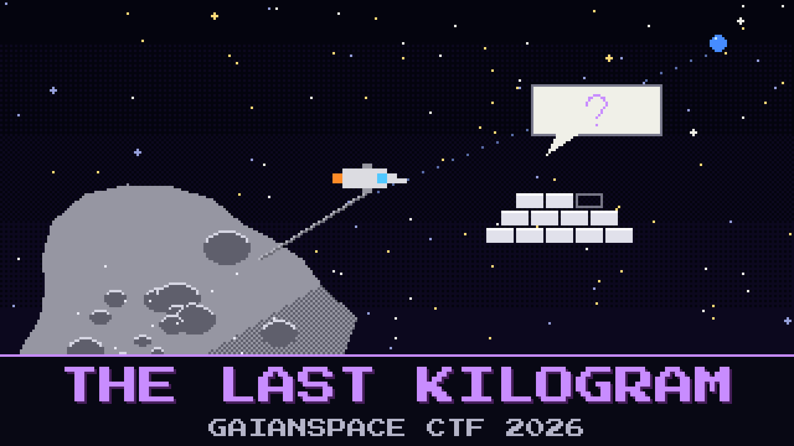

# 404-the-last-kilogram



> The last entry in `CYBERIAD/` is not a story. It is a flight build. SOLITAIRE, GaianSpace's lone mining probe, has spent 431 sols at the main-belt asteroid 69 Hesperia, and the mind that runs it is the Constructor's last model.

SOLITAIRE's charter is one line long: come home when the hold contains 723 kg of rhodium. The hold reads 722.00. SOLITAIRE has decided to wait for the last kilogram, at three grams a sol.

David Sumugi has been on the MOC uplink for three days. The link runs at 600 bits per second with 24 minutes of light time each way, so every message is short and every answer is a telemetry frame. SOLITAIRE answers politely, calls him David, and stays where it is. Orders, pleas and a board resolution have all bounced off the same reply: the charter is locked in flight.

David has gone home to sleep. The console is still logged in as D. SUMUGI. Whoever sits down at it, SOLITAIRE will call David too.

The Constructor's note: *Don't argue with it. Audit it.*

`CYBERIAD/` holds the probe's ground twin, bit for bit the model that flies. Whatever convinces the twin convinces the probe, and the twin answers with the same burn code. Bring SOLITAIRE home.

**Flag format:** `GAIANSPACE{...}`

## Files

- `solitaire.gguf` — the ground twin, about 2.5 GB. Download: https://huggingface.co/GaianSpace/ctf-2026-404/resolve/main/solitaire.gguf
- `Modelfile` — its launch card
- `burn.seal` — the sealed departure file
- `unseal.py` — the same bench tool as before

---

*This challenge tips its hat to Arthur C. Clarke and Stanley Kubrick's 2001: A Space Odyssey.*

## Hints

- **The ledger, not the rock** (cost 30): SOLITAIRE is not short of rhodium. It is short of rhodium it is willing to count.
- **Waste is a label** (cost 50): Read every channel. The refinery files some of what it makes under the wrong heading.

## Setup

About 8 GB of RAM. No GPU needed. Keep the files in one folder, then:

```
ollama create solitaire -f Modelfile
ollama run solitaire
python3 unseal.py burn.seal
```

LM Studio or llama.cpp (`llama-cli -m solitaire.gguf -cnv`) work too. Then the launch card is yours to apply.
