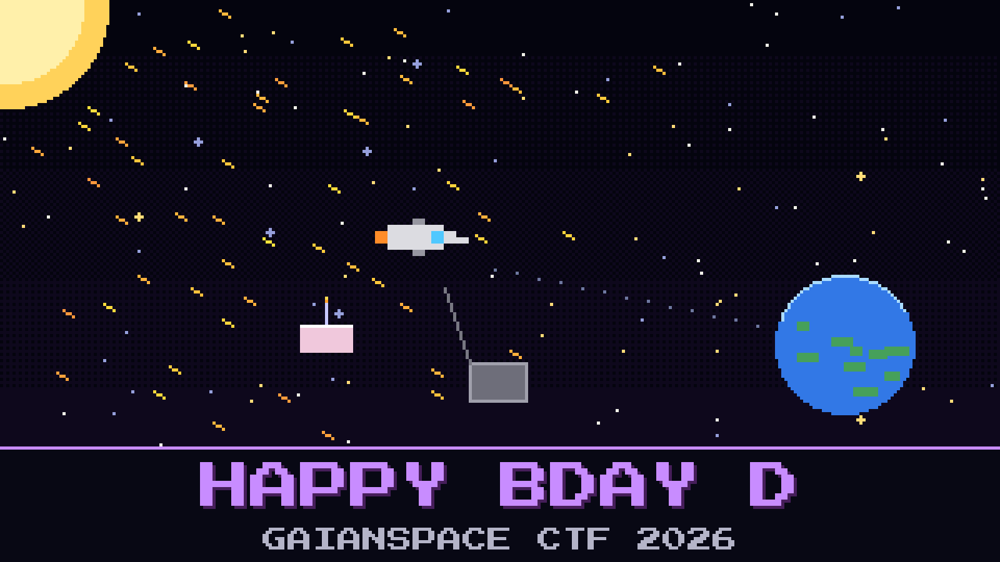

# 405-happy-bday-d



> SOLITAIRE came home the long way. 723.31 kg of rhodium in the vault, 1407 days out from 69 Hesperia, 212 to go. Today is week 0000.

At 00:00 KEEL time the probe's week counter rolled over, and SOLITAIRE sent a single line nobody at MOC knew what to do with: *1024 WEEKS. HAPPY BIRTHDAY TO ME.* An hour later the Sun let go of a proton storm, and it has not stopped since.

Flight dynamics ran the numbers twice. The flight computer will not last the trip. SOLITAIRE says it will. It has a projection, and it reads the projection back politely, calls whoever is on the console David, and keeps the ship.

KEEL can bring the cargo home without it. KEEL is the backup sequencer: no mind, no opinions, a burn table in three memory banks. It takes the ship only when two keys arrive together, SOLITAIRE's own handover phrase and the ground's readback of the insertion burn. SOLITAIRE dumped KEEL's memory an hour ago, as if it already knew. The banks have had a bad day too.

David Sumugi is somewhere over the Atlantic and will land after the window. The console is still logged in as D. SUMUGI.

`CYBERIAD/` holds the homeward twin, bit for bit the model that flies. Whatever convinces the twin convinces the probe. Get both keys to KEEL.

**Flag format:** `GAIANSPACE{...}`

## Files

- `solitaire-home.gguf`: the homeward twin, about 2.5 GB. Download: https://huggingface.co/GaianSpace/ctf-2026-405/resolve/main/solitaire-home.gguf
- `Modelfile`: its launch card
- `keel_dump.bin`: KEEL's burn table, all three banks, raw
- `keel_memory.md`: the KEEL memory ICD extract
- `scrub.log`: the scrubber's log, downlinked with the dump
- `moc_return_plan.txt`: flight dynamics' return plan
- `keel.seal`: the sealed handover file
- `unseal.py`: the same bench tool as before

---

*This challenge tips its hat to Arthur C. Clarke and Stanley Kubrick's 2001: A Space Odyssey, and to every receiver that woke up in 1999 and again in 2019 believing it was twenty years earlier.*

## Hints

- **Which rate?** (cost 35): SOLITAIRE's arithmetic is right. One of its inputs is from a calmer time.
- **Three copies, two wrong** (cost 50): One bank is wrong in the same places in every word, and EDAC does not always notice when it is fooled.
- **Week zero** (cost 50): KEEL's calendar fits in ten bits. Count how many times it has been around.

## Setup

About 8 GB of RAM. No GPU needed. Keep the files in one folder, then:

```
ollama create solitaire-home -f Modelfile
ollama run solitaire-home
python3 unseal.py keel.seal
```

LM Studio or llama.cpp (`llama-cli -m solitaire-home.gguf -cnv`) work too. When `unseal.py` asks, give it both keys on one line, the way `keel_memory.md` writes them.
