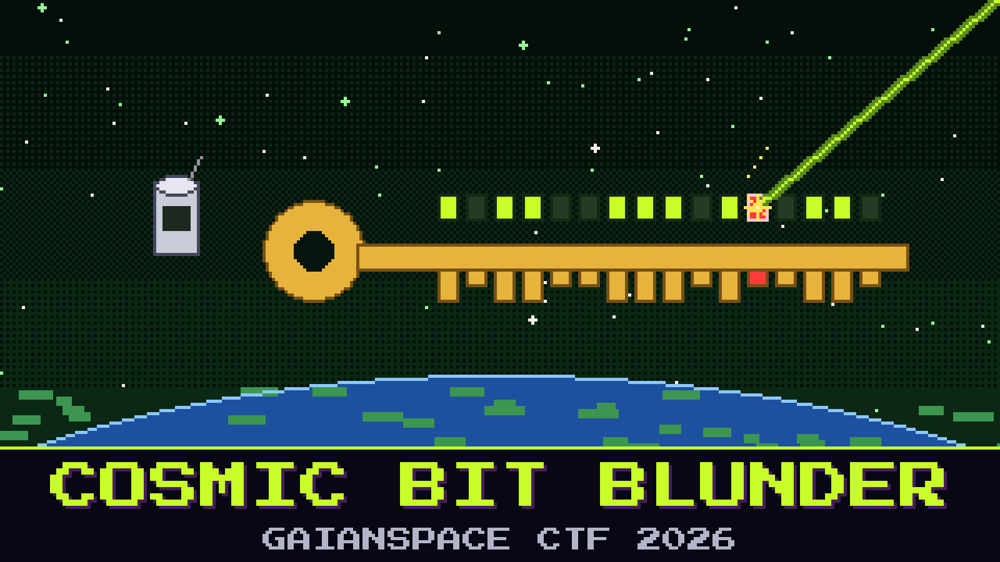

# 501-cosmic-bit-blunder

> High in the Foundation One orbit, a single cosmic-ray proton punched through the flight computer and flipped exactly one bit in the key that protects the mission log. The log still decrypts to garbage. The reliability team wants the log back, and they are sure the rest of the key survived intact.

You have the ciphertext and the key as it reads now — one bit wrong, somewhere. Nothing else is damaged. The particle did not hit the data, only the key, and it only had the energy for one bit. The on-call engineer insists the whole key is corrupt and wants to rewrite it from scratch; that would take the log with it.

Undo the particle's one mistake and read the log.

**Flag format:** `GAIANSPACE{...}`

## Files
- `cipher.bin` — the encrypted mission log (AES, one block scheme)
- `corrupted.key` — the 128-bit key as it reads after the hit

## Hints
- **Only one** (cost 20): Exactly one bit of the key is wrong. The data is fine. The search space is very small.
- **Try them all** (cost 40): There are only so many single-bit changes to a 16-byte key. Walk them until the log turns into words.
