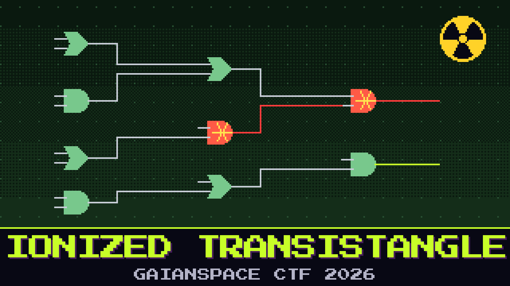

# 502-ionized-transistangle

> Months of accumulated dose finally caught up with the Foundation One status encoder. Total ionizing dose does not flip a bit and move on — it leaves transistors shorted, stuck, permanently. The encoder now spits nonsense. We still have the original design, gate for gate, with the damaged nodes marked.

The encoder turns a stream of probe words into a status line. On the bench it reads as junk, because a couple of gates are shorted and hold their outputs no matter what feeds them. The design on file is the healthy one; the shorted gates are flagged on it. Rebuild what the encoder was supposed to do, run the probe words through the intended logic, and the status line comes back.

Read the status line the encoder should have produced.

**Flag format:** `GAIANSPACE{...}`

## Files
- `status_encoder.netlist` — the gate-level design; shorted gates are tagged, probe words are listed at the end

## Hints
- **A short is a lie** (cost 30): A shorted gate ignores its inputs and holds one value. The design still records what that gate was meant to compute. Trust the design, not the short.
- **Feed the probes** (cost 50): Each output bit assembles into one character. Run every probe word through the repaired logic, in order.
