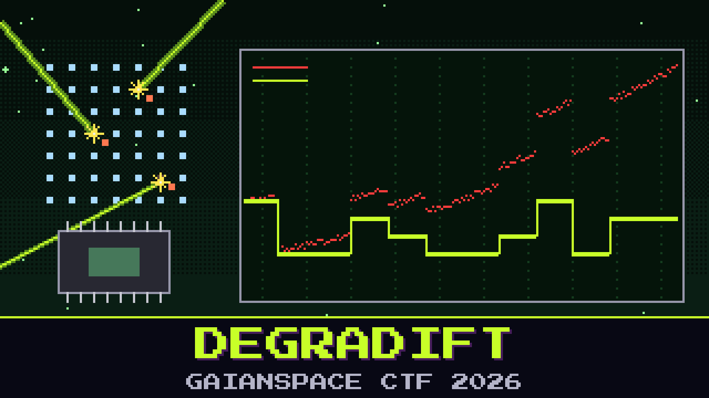

# 503-degradift

> The Foundation One CO2 sensor did not fail in a day. Displacement damage builds up: the lattice takes hit after hit, the readings creep, and by the end of the run the numbers have wandered far from the truth. We logged the whole decline. The characterization team worked out exactly how fast it drifts.

Here is the sensor diary and the drift model that fits it. Pull the drift back out of each reading and you are left with what the sensor was really seeing. The on-call will tell you the recovered numbers are just cleaner CO2 readings. Look at them again. They are not CO2.

Recover the as-flown readings and read what they spell.

**Flag format:** `GAIANSPACE{...}`

## Files
- `sensor_log.csv` — sample index and the degraded reading
- `ddd_characterization.md` — the measured drift model

## Hints
- **Creep, not jump** (cost 30): The error grows with every sample along the curve in the characterization note. Subtract the modelled drift from each reading.
- **Not parts per million** (cost 50): The cleaned numbers are not a gas concentration. They sit in a familiar range once you shift off the baseline. The mission format tells you the first character.
