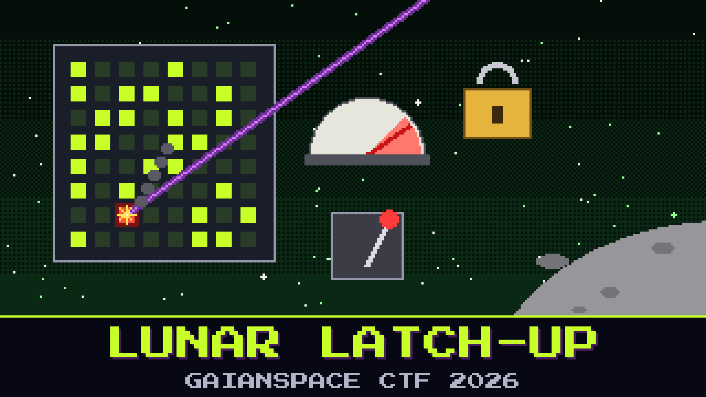

# 504-lunar-latch-up

> A single heavy ion hit the Foundation One power-management block and triggered a latch-up — a parasitic path that slams one bit high and holds it there, drawing current until someone cuts the rail. We dumped the register file mid-event. One bit in there is stuck high that should not be. Everything downstream is keyed off those registers, so until the latched bit is reset, the sealed mission payload stays sealed.

The dump is the eight power registers exactly as they latched, the integrity word the block stores for its own healthy state, and the sealed payload. One bit flipped high. Find it the only honest way — the one that makes the integrity word agree again — reset it, and the registers become the key they were always meant to be.

Reset the latch and open the payload.

**Flag format:** `GAIANSPACE{...}`

## Files
- `reg_dump.bin` — the latched register file, its integrity word, and the sealed payload
- `recovery_spec.md` — the power block's dump layout and key scheme

## Hints
- **One bit too high** (cost 40): The latch set a single bit. You only need to consider bits that are currently high; clearing the right one makes the stored integrity word match.
- **The registers are the key** (cost 60): Once the integrity word agrees, the corrected register bytes derive the key that opens the payload. The spec says how.
