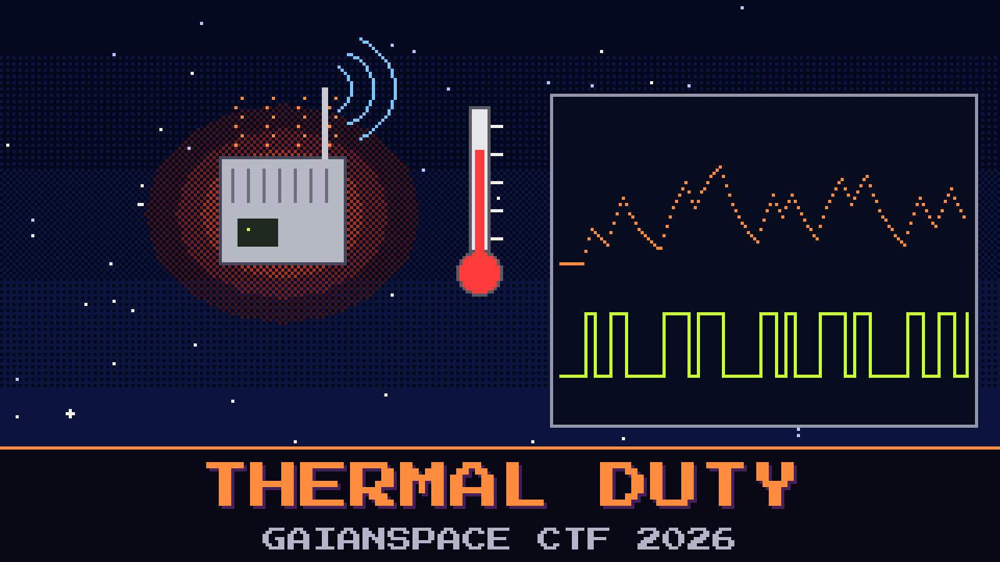

# 505-thermal-duty

> Foundation One's radio has no business running flat out — deep space is cold, but a transmitter with nowhere to dump its heat cooks itself. The flight software duty-cycles the power amplifier to stay under the limit. During one pass the housekeeping logged the PA case temperature the whole time. The thermal team wants to know exactly how hard the amplifier was being driven, moment to moment.

The temperature log is all you have; the drive signal itself was never recorded. The thermal behaviour of the case is a plain first-order model, but the sheet with its fitted constants walked out the door with the last thermal lead. Put the constants back, run the temperature curve through the model, and the drive it was fed falls out, one step at a time. The on-call swears the drive was a steady hum. It was not steady.

Recover the drive sequence the amplifier was given.

**Flag format:** `GAIANSPACE{...}`

## Files
- `thermal_log.csv` — time and PA case temperature
- `thermal_model.md` — the first-order thermal model, without its constants

## Hints
- **Driven, not drifting** (cost 30): The temperature does not wander on its own; something pushes it each step. You already know what the first few pushes spelled, so you know the drive for the first few steps.
- **Counts, then characters** (cost 50): Solve the model for the drive at each step. The recovered counts are small whole numbers, and they read as text.
