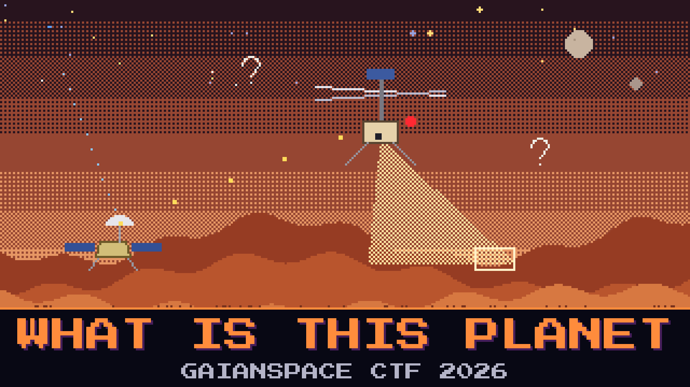

# 601-what-is-this-planet

> GaianSpace has been quietly listening to a relay that should not exist. Somewhere far from home, a small rotorcraft is flying low over red dust, filming the ground and calling home through a lander. We tapped the downlink. Before anyone argues about what it is or where it is, the stream can answer for itself — it introduces itself every time a client asks to watch.

The capture is the ground relay's view of the link: the little control chatter that keeps the aircraft alive, and the handshake that sets up its camera feed. The engineering team also recovered a design sketch of the thing's eyes — a perception stack that looks at the terrain and guesses what it is seeing and how far away it is. One analyst is adamant this is just a hobby quadcopter on someone's lawn. Watch how the camera feed names itself and decide for yourself.

Identify the platform from its own downlink.

**Flag format:** `GAIANSPACE{...}`

## Files
- `mars_downlink.pcap` — the ground relay tap (control link + camera setup)
- `perception_stack.drawio` — recovered design sketch of the onboard vision pipeline

## Hints
- **It introduces itself** (cost 20): The camera feed is set up with a short description exchange before any video flows. Follow that conversation; the stream states what it is.
- **Read the session** (cost 40): The description of the feed carries a session name. That name is the answer, wrapper and all.
