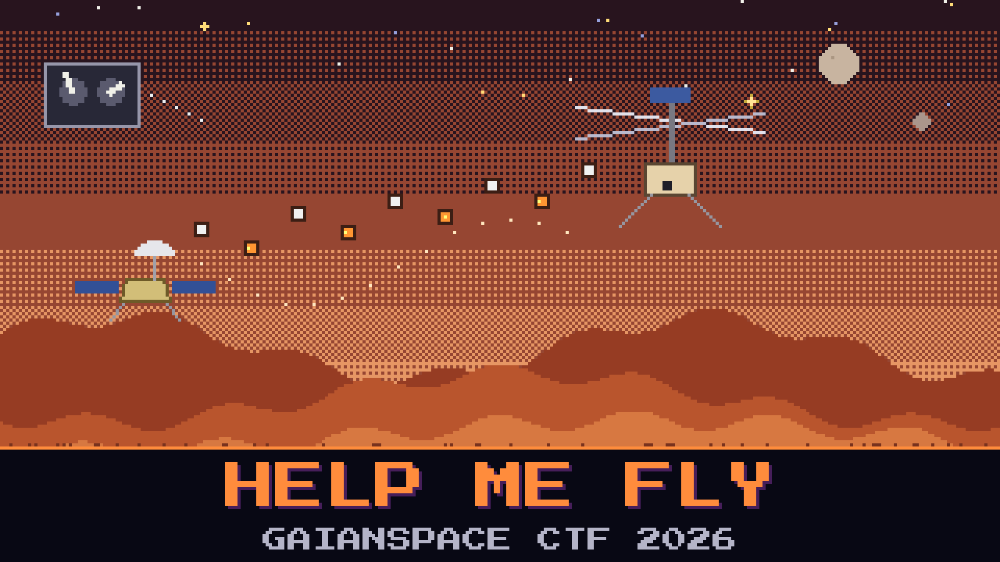

# 602-help-me-fly

> The rotorcraft and its relay never stop talking. The relay pokes it a few times a second, the aircraft pokes back, and in between the pilot's stick commands ride the same channel. We have a clean stretch of that conversation from a single flight. The flight dynamics team wants to read the aircraft's side of it — not the commands going up, but what the aircraft says as it flies.

Every poke from the ground gets an answer from the aircraft. On a parked unit those answers are all the same dull acknowledgement. This unit was not parked. As it flew, its answers carried a changing field that the pilot never sees — the kind of thing a maintenance log quietly records. Pull that field out of the aircraft's replies, keep them in the order they were sent, and the aircraft tells you something plainly.

Read what the aircraft was saying as it flew.

**Flag format:** `GAIANSPACE{...}`

## Files
- `mars_control.pcap` — one flight's control conversation

## Hints
- **The aircraft's side** (cost 30): Separate the aircraft's replies from the ground's pokes. Every answer to a poke starts with the same two-byte tag. Anything the aircraft sends on its own carries a different tag.
- **One field, in order** (cost 50): A parked unit always answers with zeros. In flight, one byte of each reply changes. Collect that byte across the replies, in sequence. The radio link is not polite: replies arrive late, out of order, and sometimes twice. The last two bytes are the aircraft's own counter, low byte first.
