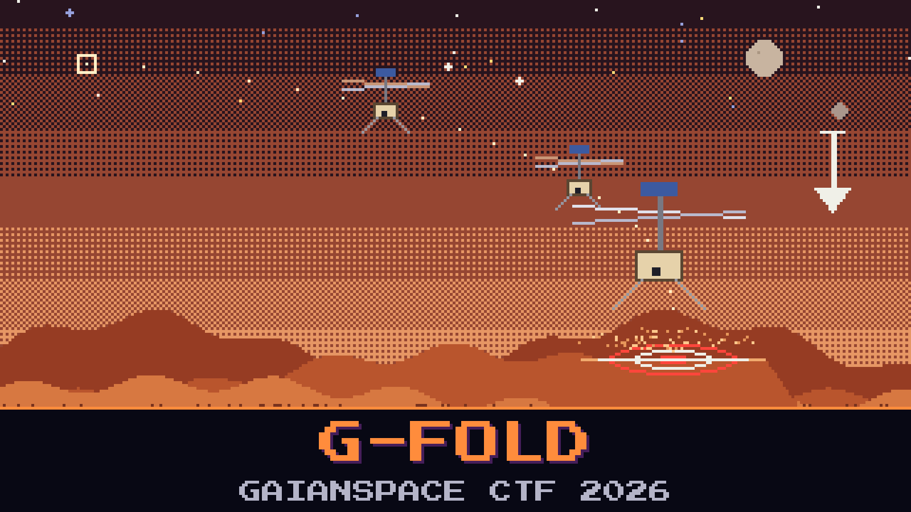

# 603-g-fold

> The rotorcraft cannot just drop onto a survey site — the air is too thin to glide and the ground is unforgiving. Its guidance computer runs a powered-descent solution (the g-FOLD family): a thrust plan that flies it from release down to a controlled touchdown. We recovered the thrust plan it used for one descent, along with the state it started from. Mission wants to know exactly where that plan puts it on the ground.

You have the computed thrust-acceleration plan, step by step, and the release state. Gravity out there is not Earth's. Fly the plan forward from the release point under the local gravity and see where it sets down. The on-call engineer keeps eyeballing the horizontal thrust and guessing a spot; the only way to know is to integrate it.

Compute the landing site.

**Flag format:** `GAIANSPACE{LZ_<x>_<y>}` — x and y in metres, each rounded to the nearest 10 m (negative allowed). For example `GAIANSPACE{LZ_120_-40}`.

## Files
- `descent_profile.csv` — the guidance thrust-acceleration plan (inertial frame)
- `gfold_notes.md` — release state, constants, and how to integrate

## Hints
- **Thin air, hard ground** (cost 30): This is not Earth. Use the gravity in the notes, not 9.81.
- **Fly the plan** (cost 50): Add gravity to each thrust sample, step the velocity then the position, and stop when it reaches the ground. The horizontal position there is the site.
