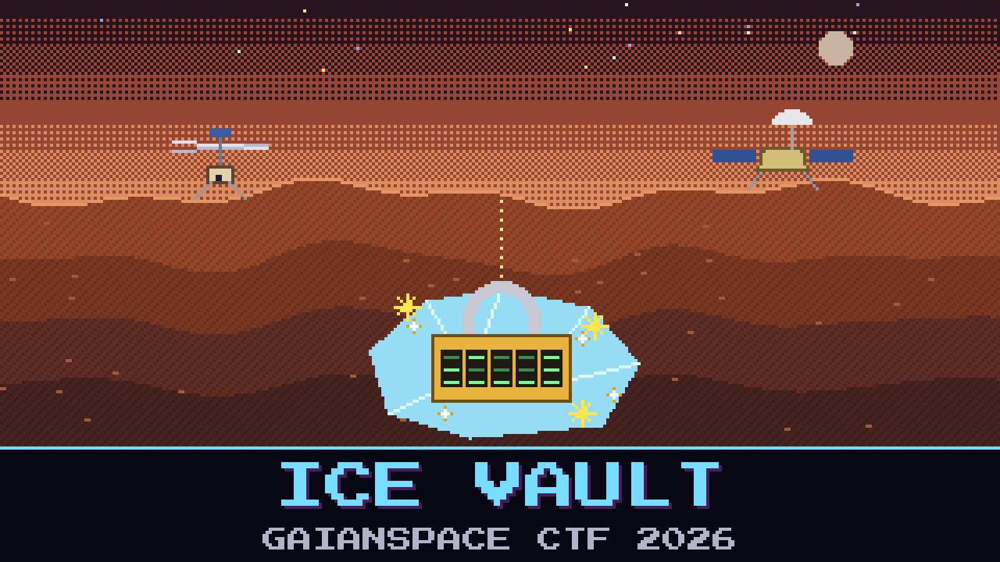

# 604-ice-vault

> This is what the whole flight was for. DR-ONE's survey confirmed a buried target, and the mission team sealed the coordinates in a vault before relaying anything home — no site location was ever sent in the clear. We pulled the sealed vault off the relay. The only thing standing between us and the find is the lock the field team threw on it in a hurry: a short, sloppy maintenance passphrase, five lowercase letters and not a real word, the kind of thing they rotate every sortie and never write down.

Short and sloppy, and in the end not even secret: the relay crew caught a field tech reading it out over an open voice loop, and it is in the hint. What is inside is the thing everyone has been after: where the ice is.

Open the vault and read the find.

**Flag format:** `GAIANSPACE{...}`

## Files
- `mission_vault.7z` — the sealed survey vault
- `vault_notes.md` — what the field team said about the lock

## Hints
- **Passphrase** (cost 0): The archive passphrase is `qvfzk`. Open `mission_vault.7z` with it and read the site.
