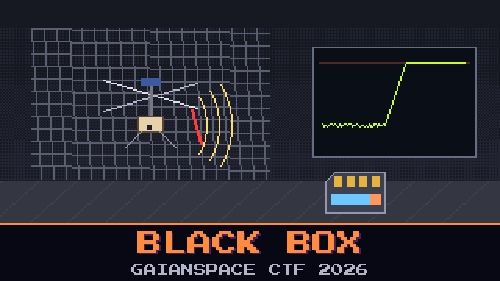

# 605-black-box

> Two days after the ice find, DR-ONE took off for one more look at the site and never called back. Then something new came down the relay we tap: not telemetry, a file.

The operators had pushed it up to the lander for its fault software to compare against: the black-box card of DR-ONE-Q, their qualification twin. Same airframe, same firmware, same config. They flew it through DR-ONE's last flight in a test hall on Earth, and the twin went down too. The impact pulled its battery, but the card survived, and we caught the image on its way up.

The operators' own note blames the rear servo, and it tested fine.

The mission team wants two things from the twin's card: which swashplate servo quit, and the moment the flight controller lost its gyro, the first sample where the sensor was pinned at the end of its range and the controller was flying blind.

**Flag format:** `GAIANSPACE{S<servo number>-T<tick>}` — `<tick>` is the black box's own `ticks_ms` value of the log block that holds the first clipped gyro sample. For example `GAIANSPACE{S3-T12345678}`.

## Files

- `bbx_sd.img.gz` — the twin's black-box card, as caught on the relay
- `drone_config.md` — DR-ONE's configuration page, as sent with the card
- `hall_notes.md` — the operators' test-hall note for the rerun

## Hints

- **Last sync** (cost 40): A black box doesn't tell the card about everything it writes the moment it writes it. The card holds more than the file admits, and some of what follows isn't from this flight.
- **Pinned** (cost 60): Gravity can't be mounted the wrong way round, and neither can a flight you watched. Find the nose and the way down in the data before you trust a page, or a gyro, that says otherwise.
