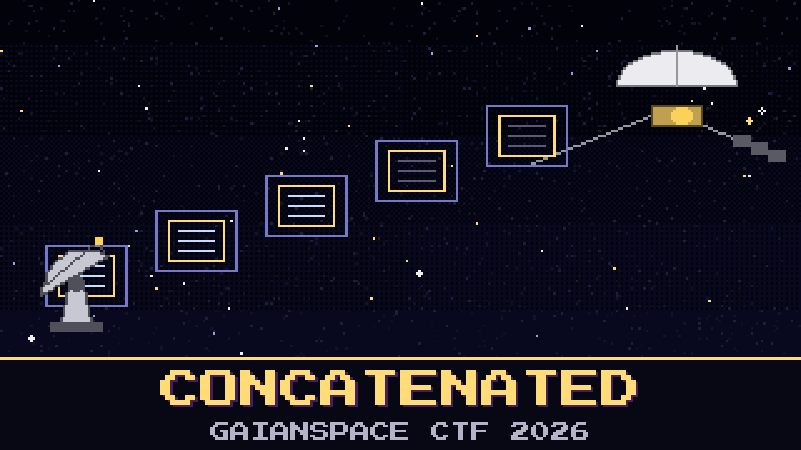

# 702-concatenated

> The command to dump the data computer's memory went out a day ago. The answer arrived tonight, as faint as anything the station has ever locked onto.

Pilgrim-1 obeyed. It read back its own memory and sent it home. At this distance the signal is barely above the noise, which is why the 1977 designers wrapped every frame in two codes, one inside the other. The station recorded the raw symbols. Nobody on the desk has decoded a Pilgrim-1 readout since the 1990s.

Somewhere in the readout the computer signs its name.

**Flag format:** `GAIANSPACE{...}`

## Files

- `pilgrim_symbols.s8` — the raw received symbols, signed 8-bit
- `coding_sheet.md` — what is left of the handbook page on the coding

## Hints

- **Not just yes or no** (cost 30): Every sample says how sure the receiver was, not only which way it leaned. Throwing that away costs more than this link can afford.
- **Four at a time** (cost 50): The outer code never sees the bytes in the order they arrived.
