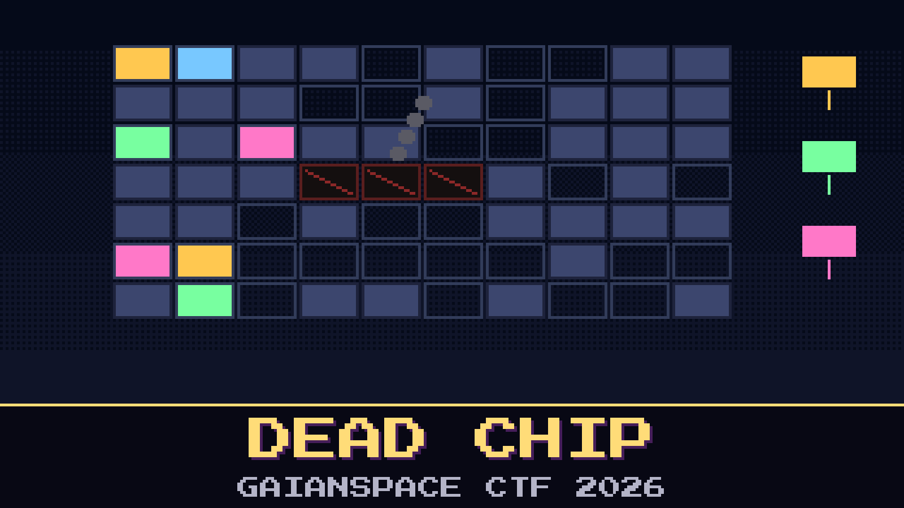

# 704-dead-chip



> The readout came back clean, and it says what everyone feared. One memory chip in the old data computer is gone. Everything Pilgrim-1 says about itself goes through that chip.

A piece of Pilgrim-1's flight data subsystem has stopped holding anything. The routine that lived there builds every telemetry frame, and now the computer falls over every time it calls it. There is no spare chip. All the ground can do is what the engineers who built it would have done: pick the routine up, cut it into pieces, and fit it into whatever corners of memory are still free. Then send that over a link that carries a few words a second, with one pass to get it right.

The desk has the 1977 ground copy of the memory, the handbook, and a bench model of the machine. When the patch is right, the spacecraft will sign its name again.

**Flag format:** `GAIANSPACE{...}`

## Files

- `fds_golden.img` — the ground's copy of the data computer's memory, 2048 big-endian 16-bit words
- `fds_sim.py` — the ground's bench model of the machine
- `fds_handbook.md` — the instruction set, the 1977 memory map, and the load history

## Setup

Python 3, nothing else. Run the spacecraft as it is now, then with your patch:

```
python3 fds_sim.py fds_golden.img
python3 fds_sim.py fds_golden.img my_patch.txt
```

## Hints

- **Not every door is a call** (cost 40): Something outside the bank reaches into it without a `JSR`. Find every way in before you move anything.
- **Free since when** (cost 60): The map was drawn before the last time somebody squeezed something in. Look at what is in memory, not at what the map promises.
