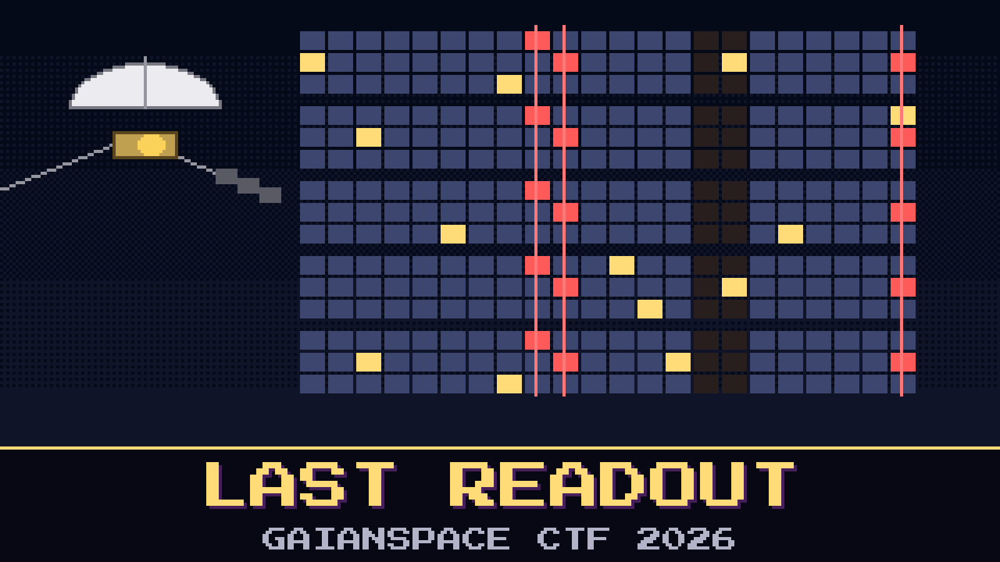

# 705-last-readout

> Pilgrim-1 signed its name again, two days after the patch went up. Ines didn't open the champagne. She ordered five full memory readouts instead.

One chip in the old data computer died this month. Chips in the same batch, the same age, under the same radiation, tend to go together. If a second one is starting to fail, the desk wants to know now, while the patch still works, and not after the next safe mode, a light-day away.

The five readouts came home on two passes, each one a fresh read of the whole memory. The link was poor. The receiver loses its grip at the end of every long frame, and the checksum fails on about half the frames. Ade has already diffed the first readout against the golden image and has a list of four hundred dead cells. He wants to send it to engineering.

Find the words that Pilgrim-1 itself has lost.

**Flag format:** `GAIANSPACE{<addresses of the damaged words, three hex digits each, ascending, joined with hyphens>}` — for example `GAIANSPACE{0A1-2F0-7FF}`. Leave out bank 3 lower (`600`–`6FF`); everyone knows about that chip.

## Files

- `readout_frames.log` — the station's log of every readout frame as received
- `readout_notes.md` — the desk's notes, with the readout frame format
- `uplink_2026-10-11.txt` — the patch that went up, exactly as sent
- `fds_golden.img` — the ground's 1977 copy of the memory
- `fds_sim.py` — the ground's bench model of the machine
- `fds_handbook.md` — the instruction set, the memory map and the load history

## Hints

- **Same mistake twice** (cost 30): The link makes a different mistake every time. The spacecraft makes the same one every time.
- **It writes too** (cost 50): Not every word that changed is broken. The machine changes some of its own memory every cycle.
