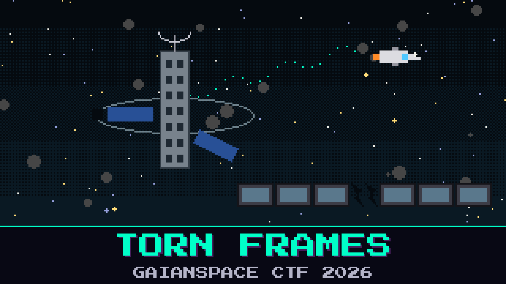

# 801-torn-frames

> Stardate 2189. The salvage tug *Meridian Kestrel* has been sitting beside the derelict relay **HALCYON-7** for six hours. The relay has been dark for forty years. Tonight a thin carrier keeps climbing out of the belt, and the bridge wants the name of whoever left it running.

Signals officer Tamsin Oduya pulled the tuner stick and kept whatever the front end would give her. The capture stops and starts, like someone tapping a microphone with a bad cable. She told the bridge the owner’s name is still inside the broadcast the relay has been shouting at nobody. She also told them the first theory is usually the wrong one.

A plate on the rack reads `PAL / 625`. Under it, in grease pencil: `weather fax?` The console still shows a lock from another pass, `11786.420`, which Oduya says belonged to a different bird. The carrier has not introduced itself.

Find the name the old operator left on the stream.

**Flag format:** `GAIANSPACE{...}`

## Files
- `halcyon_dump.bin` — the tuner stick, copied off in a hurry
- `operator_log.txt` — Oduya’s notes from the same watch

## Hints
- **Short breaths** (cost 20): Oduya says the relay blinks, goes quiet, then blinks again. She stopped laying one ruler across the whole reel.
- **The quiet is the cable** (cost 40): The gaps are the tuner catching its breath. Whatever name is left lives in the blinks, not in the silence between them.
