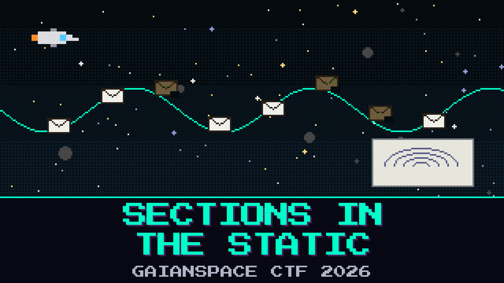

# 802-sections-in-the-static

> The name on the relay was only the letterhead. Under it, Oduya hears a second conversation riding in the same carrier, the way a whisper rides a shout. HALCYON-7 was forwarding someone else’s words. The link faded while it did, and it repeated itself. Some of the repeats came back rotten.

She kept the grab anyway. The crew log is in there, split across the copies that still hold together. Pell has already decided it is the television picture from the rack plate, and he has written a channel number on the tape that belongs to a weather chart from last month.

Pull the crew’s words out of the static. Leave the rotten copies where they fell.

**Flag format:** `GAIANSPACE{...}`

## Files
- `eumetcast_grab.ts` — the grab, this one continuous
- `mpe_notes.md` — a page from a weather-bird handbook, torn at the corner

## Hints
- **The seal** (cost 25): Oduya keeps a page only when its seal still matches. The faded repeats go back into the static.
- **Numbered in the sending** (cost 50): The crew marked the good pages in the order they were sent. The fade did not respect that order.
