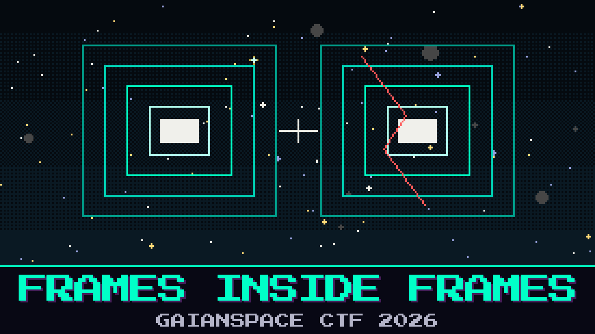

# 803-frames-inside-frames

> Oduya was wrong about the shape of the pipe. Under the mailbox there is another wrapping, and under that a message that would not fit in one breath. The relay split it. The fade, helpful as ever, kept a second copy that looks just as sure of itself.

She swears this is not the same trick as last watch. Pell swears it is, and he has already started on the old handbook. One of the copies reads like a confession. The other only pretends to.

Find the copy that survived whole.

**Flag format:** `GAIANSPACE{...}`

## Files
- `relay_bbframes.ts` — another grab from the same dish
- `bbframe_notes.md` — what is left of the frame manual after the coffee

## Hints
- **Not the mailbox** (cost 30): Last watch’s handbook will open something. It will not open this. The message is wrapped, and then wrapped again.
- **The copy that checks** (cost 50): Two versions want to be believed. Only one of them still matches itself once the pieces are put back.
