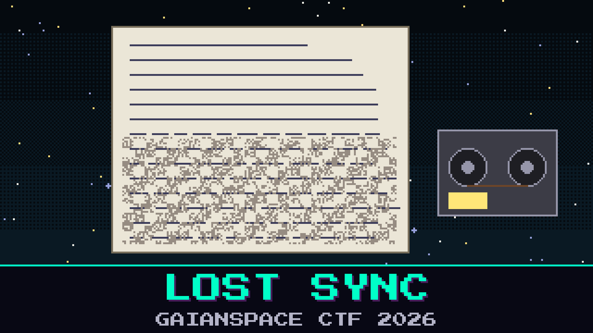

# 804-lost-sync

> The recorder woke up late. Oduya has the relay’s own maintenance log, and the file begins in the middle of a breath, not at the start of anything. This is not the crew mailbox and not the split letter from the last grab. It is HALCYON talking to itself.

Part of the log is written in a steady hand. The rest is the same hand dragged through one smudge, over and over. The bridge wants the station’s last words, the ones under the smudge.

A sticker on the recorder says the key is the stardate. Oduya tried that before she saved the file. It is not the stardate.

**Flag format:** `GAIANSPACE{...}`

## Files
- `halcyon_mid.bin` — the log, started too late
- `stationlog_format.md` — a fragment of the maintenance manual

## Hints
- **Started late** (cost 30): The beginning of the file is not the beginning of a frame. Walk until the frame is willing to introduce itself.
- **The clean line** (cost 40): One line of the log was never smudged. It talks about the ink. The ink is the same on every other line.
