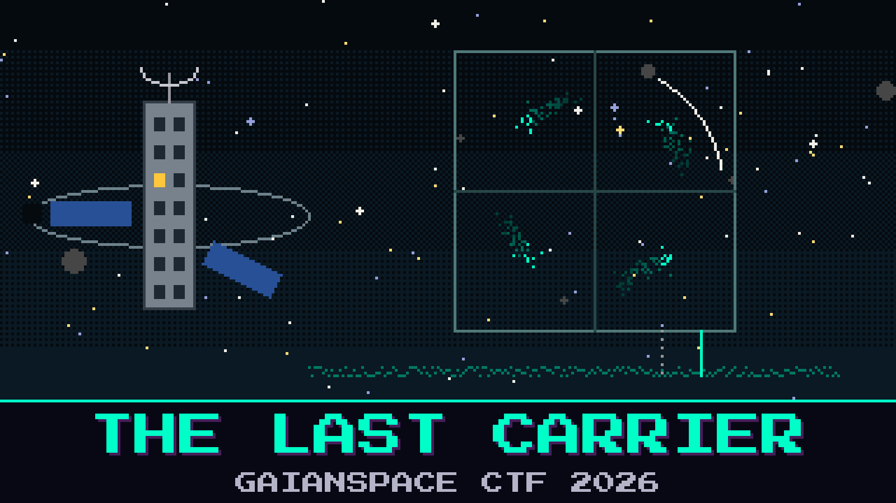

# 805-the-last-carrier

> One carrier is still up. It is thin, it has wandered off the frequency the chip expects, and it keeps repeating a single frame into the dark. No demodulator on Meridian Kestrel will lock it. Oduya saved the raw sky, the sampler’s own card, and a physical-layer page with coffee through the handshake.

Pell thinks it is the same picture mode as the plate on the rack, one bit at a time. The page under the coffee says the letters ride four phases, and that the frame bows with the same word twice before it speaks.

Lock it by hand. Read HALCYON-7’s last transmission.

**Flag format:** `GAIANSPACE{...}`

## Files
- `halcyon_iq.cs16` — the raw sky, as the sampler wrote it
- `halcyon_iq.json` — the numbers the sampler printed on its own card
- `plheader_ref.md` — the physical-layer page, stained

## Hints
- **Four times around** (cost 40): Oduya says the carrier is spinning faster than the letters. Count the spins before you believe the tone.
- **The bow** (cost 60): The frame announces itself with the same word twice. Turn the page until that word sits upright, and the letters follow it.
