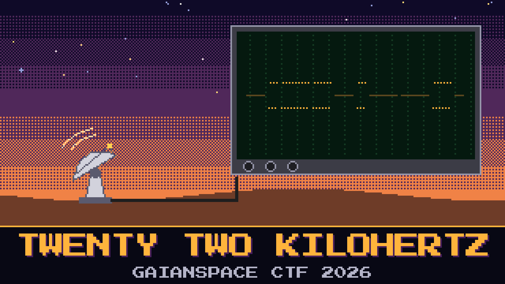

# 901-twenty-two-kilohertz

> The deep-field ground station **Kestrel Array** has started disobeying. During the uplink window the dish walks off the bird, comes back, and walks off again. Engineer Ravi Lindqvist clipped a scope onto the motor coax to hear who is giving the orders.

What he caught is not a voice. It is the old whistle the positioner uses when it wants the motor to move, chopped into moments that are lit and moments that are not. Lindqvist is sure the whistle is spelling. He is less sure he wants to know who taught it to spell.

A jacket label on the coax reads `LNB 10.6`. Someone added `listen for the pilot` in pencil. The night log also mentions a Morse practice tape in the same drawer as the scope. Lindqvist played it. It is a person sending the station callsign, badly, and it is not this recording.

Read what the motor was told.

**Flag format:** `GAIANSPACE{...}`

## Files
- `coax_tap_22k.wav` — scope tap from the motor coax
- `diseqc_notes.md` — Lindqvist’s card, coffee on the corner

## Hints
- **The lamp** (cost 20): Lindqvist says ignore the song. Watch whether the lamp is lit.
- **Manners** (cost 40): A long glow and a short glow are not the same word. He saves one tick in each little group for luck, and luck is not one of the letters.
