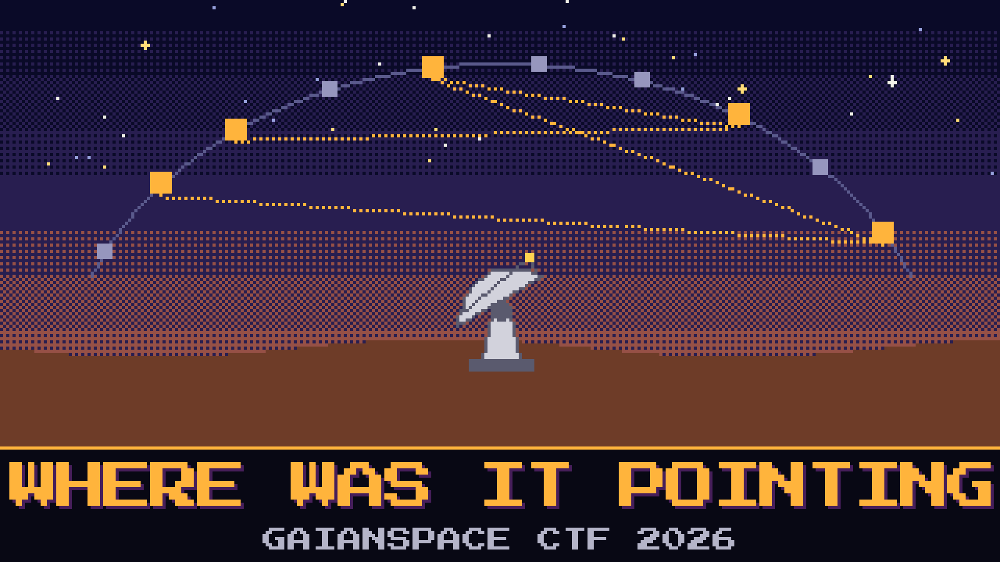

# 902-where-was-it-pointing

> Lindqvist has the night the dish walked. The motor was not drifting. Something was giving it places to go, and the station already keeps a catalog of the places it is willing to believe in. Each place remembers a scrap of a name.

Most of the trace is the motor clearing its throat. A few lines are the ones that named a destination. Pell divided the last byte by ten and announced a bearing. The dish did not go there.

Walk the destinations in the order the dish was sent. The scraps, in that order, are the proof.

**Flag format:** `GAIANSPACE{...}`

## Files
- `slew_log.txt` — the orders, as the controller spoke them
- `catalog.json` — the sky Kestrel Array is willing to believe
- `motor_notes.md` — Lindqvist’s card, rewritten twice

## Hints
- **The long orders** (cost 30): The short lines start the motor and stop it. The lines that name a place are the longer ones.
- **Finer than a degree** (cost 40): The old positioner does not speak in whole degrees. The catalog already stores the angle the motor would be given. East and west are not the same direction.
