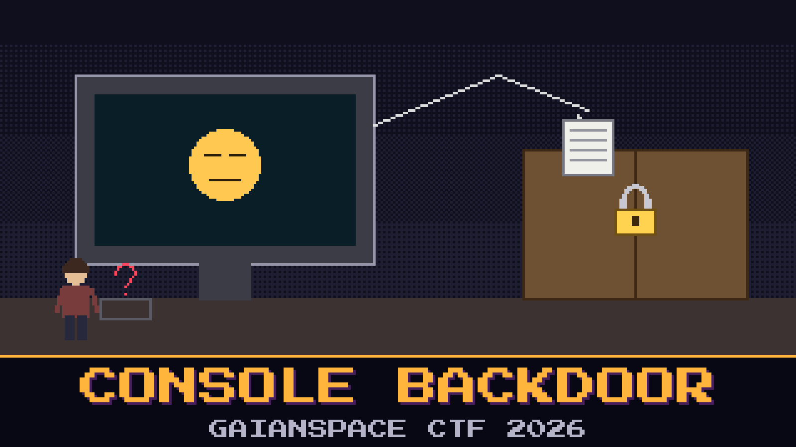

# 903-console-backdoor



> The intruder did not kick the door. The mission console let them point at a page, and the console went and fetched it. Lindqvist has the console on the bench. It still imports pieces of the catalog that way. The pass schedule is the page it is trying not to show him.

Pell is brute-forcing the login form. There is no login form. The health page will only tell you the console is bored.

Bring the console up yourself. Ask it for the page it thinks it is too well-mannered to open.

**Flag format:** `GAIANSPACE{...}`

## Run it
Unzip `service.zip` so the folder is named `service`, then from that folder:

```
docker compose up --build
```

The console listens on http://localhost:8000. It does not need the open network. A catalog directory and a Python interpreter are enough if you would rather not use Docker.

## Files
- `service.zip` — the console, as Lindqvist copied it off the bench

## Hints
- **The pointer** (cost 30): The import desk believes the path it is handed. It was written to be helpful.
- **Next door** (cost 50): The schedule is not in the catalog drawer. It sits in the room beside it. Nobody told the desk to stay in the hallway.
