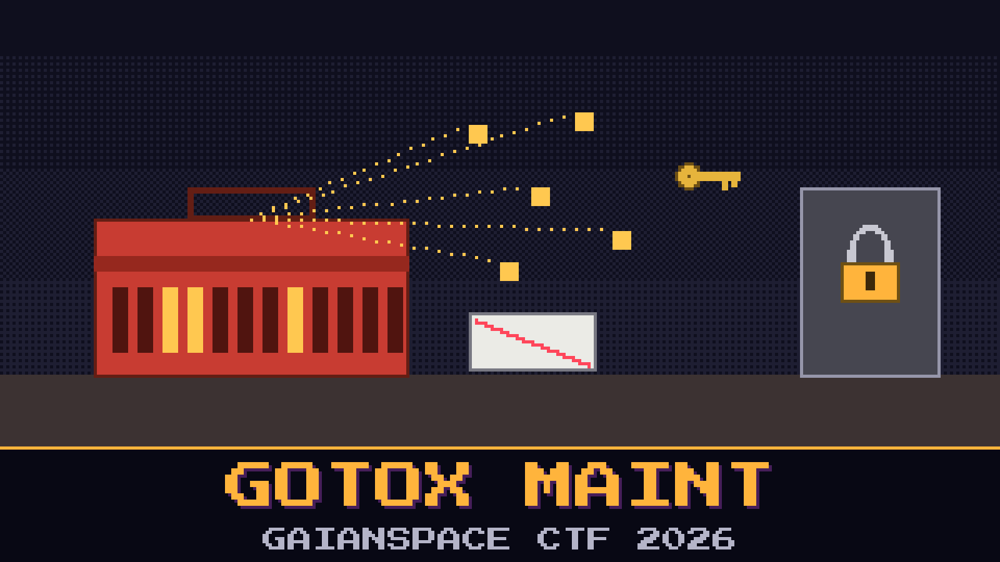

# 904-gotox-maint

> The dish unlocked itself with the station’s own maintenance tool. Lindqvist pulled `gotox-maint` off the controller before anyone could be brave about it. The tool will not talk until it is shown a key. The key is not on a sticky note. The tool builds the key while it runs, out of marks it already carries.

A laminated card in the drawer says the night-shift default is `MAINT-0000-0000`. Lindqvist tried it. The tool laughed, in the only way a tool laughs, which is by staying locked.

The token it prints, once it believes you, is what the bridge asked for.

**Flag format:** `GAIANSPACE{...}`

## Files
- `gotox-maint` — the tool, copied off the controller
- `maint_notes.md` — the drawer card, including the lie

## Hints
- **Ask it properly** (cost 30): The night shift did not patch the tool. They invoked it, and they passed the key in the open.
- **Two stamps** (cost 50): The key is not a dictionary word. It is two marks the tool already knows, printed into the shape of a nameplate.
