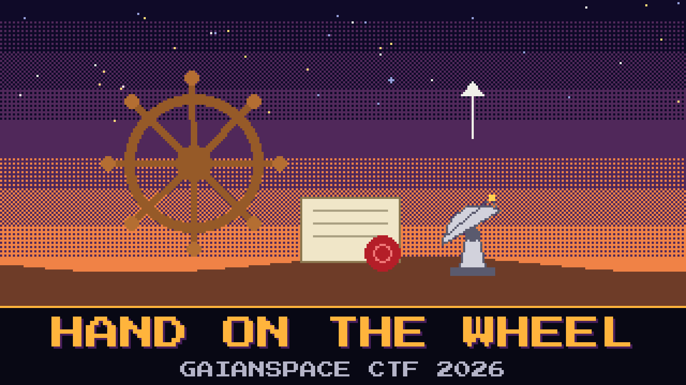

# 905-hand-on-the-wheel



> Last of the night. The positioner will not move for a shouted order. It only believes an order that carries the same seal as the ones already in the log. Lindqvist has those orders. He does not have the seal’s secret, except he almost does.

The integer day is painted on the wall of the control room: **26278**. The fraction after the dot was scratched off the whiteboard and out of the log. Pell thinks the secret is the station’s name said three times. The station’s name is not a secret. It is printed on the door.

The console will park the dish at home for anyone who can seal that order. The same secret opens a copy of the token Lindqvist already lifted off the disk, if you would rather not ask the console.

**Flag format:** `GAIANSPACE{...}`

## Run it
Unzip `service.zip` so the folder is named `service`. The fraction is not in the folder. When you have the full epoch, from that folder:

```
TLE_EPOCH='26278.?????' docker compose up --build
```

The console listens on http://localhost:8000.

## Files
- `signed_cmds.log` — orders the positioner already believed
- `slew_protocol.md` — Lindqvist’s notes on how an order is supposed to look
- `service.zip` — the console, and the sealed copy of the token

## Hints
- **Orders already believed** (cost 40): Every line in the log was accepted. That is a conversation you can check a guess against.
- **After the dot** (cost 60): The day is painted on the wall. What is missing is the short fraction a clock writes after the dot, and nothing else.
