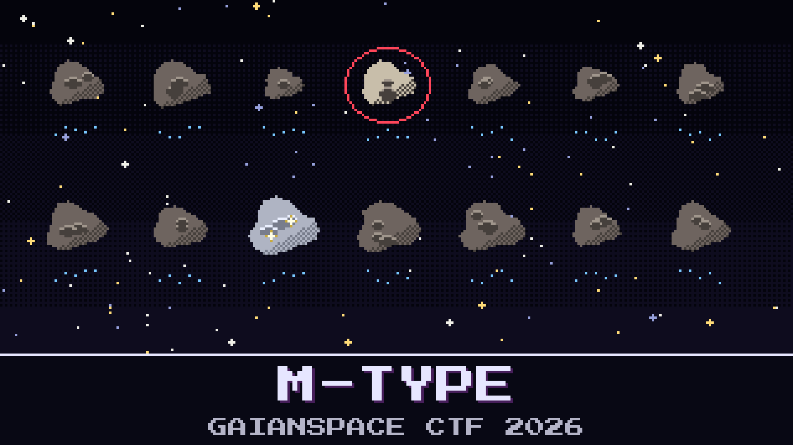

# 110-m-type

> AsterOre Inc. has hundreds of prospectors out among the near-Earth rocks and one more sitting fuelled in its parking orbit. It needs a name before morning.

Prospecting lead Sunniva Haldane hands you last night's survey: fourteen new rocks, a spectrum for each, an albedo from the thermal survey, and whatever radar time the desk could beg. Somewhere in the sheet is the only one worth the trip, a metal-rich body with platinum-group metals in it. Kaito, on nights, already circled the brightest one. He is sure. He is usually sure.

Sunniva will sign the order only with the rock's designation and its size.

**Flag format:** `GAIANSPACE{<designation with the space removed>_<diameter in metres, rounded to the nearest 10>}` — for example `GAIANSPACE{2039AB1_350}`.

## Files

- `spectra.csv` — reflectance spectra, 0.45–2.45 µm, normalized at 0.55 µm, one column per rock
- `survey_night.csv` — absolute magnitude and visible albedo from the thermal survey
- `radar_notes.md` — the radar log and the desk's notes from the same night

---

*The PGM Rush is inspired by AstroForge, whose unusually open mission updates show how cheap, autonomous deep-space spacecraft could open the solar system not only to asteroid mining but to faster, cheaper science for everyone.*

## Hints

- **Same face, different shine** (cost 20): Several rocks have the same flat, featureless spectrum. They are not the same kind of rock. The spectrum alone cannot tell them apart.
- **Size from brightness** (cost 40): A rock's size is not in the survey sheet, but the two numbers that give it are.
