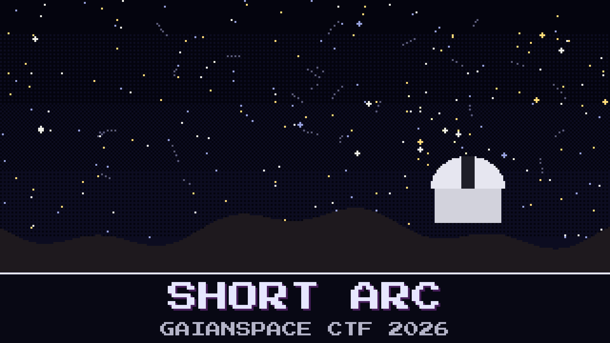

# 111-short-arc

> The rock has a name now. Nobody has seen it in three weeks.

`2041 QM23` was found close, fast, and on a short arc: three nights, then it faded into a crowded patch of sky. Prospector AO-111 leaves next week and needs to know which faint dot is the rock. The desk asked Cerro Tololo to take two exposures of every field where it might be. Their pipeline sent back every moving thing it found. There are dozens.

Kaito has already fitted an orbit on his laptop and picked the closest dot to his prediction. Sunniva has stopped believing laptops that were set up in a hurry.

Name the tracklet that is `2041 QM23`.

**Flag format:** `GAIANSPACE{<tracklet>}` — for example `GAIANSPACE{RTABCDE}`.

## Files

- `2041QM23.obs` — every position measured so far, MPC 80-column format
- `recovery_tracklets.csv` — the moving objects from the recovery night, two positions each
- `station_notes.md` — the desk's follow-up log, including what the stations said

---

*The PGM Rush is inspired by AstroForge, whose unusually open mission updates show how cheap, autonomous deep-space spacecraft could open the solar system not only to asteroid mining but to faster, cheaper science for everyone.*

## Hints

- **Close company** (cost 30): At this distance it matters where on Earth each telescope stands.
- **A good clock** (cost 50): Not every night in the log deserves the same trust. A position is only as good as the time stamped on it.
