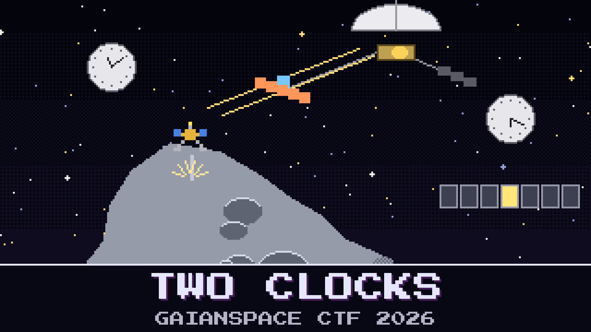

# 112-two-clocks

> 16:47 UTC on 4 November 2041. AO-111's lander fires its anchor into `2041 QM23`. Five hundred metres above it, the mothership's hover camera is shooting twenty frames a second.

The core under the anchor is the one that matters, and the geologists want to see where the harpoon went in: metal, or the dark streak beside it. That means the one frame that opened just after the bite. The lander knows the moment of the bite only by its own clock. The camera knows only the mothership's. The two clocks are tied together through the time-transfer pings on the lander link, and the lander kept its radio quiet through the whole anchor sequence.

Kaito has done it the usual way: take each ping's round trip, assume half of it each way, line up the clocks, read off the frame. He is sure. Sunniva wants it done properly before anyone writes a press release about the streak.

Name the frame.

**Flag format:** `GAIANSPACE{<frame number, seven digits, as in the frame index>}` — for example `GAIANSPACE{0400123}`. It is the first frame whose exposure started after the anchor bit.

## Files

- `mothership_tt.log` — the mothership's time-transfer log for the lander link
- `lander_events.log` — the lander OBC's event log around the anchor sequence
- `hover_frames.csv` — the hover camera's frame index for the anchor sequence
- `tt_icd.md` — the time-transfer service, from the AO-111 interface control document

---

*The PGM Rush is inspired by AstroForge, whose unusually open mission updates show how cheap, autonomous deep-space spacecraft could open the solar system not only to asteroid mining but to faster, cheaper science for everyone.*

## Hints

- **Halfway is a guess** (cost 30): Half the round trip each way is right only when both directions take the same time. On this link they don't, and the radio settings tell you exactly how long each one takes.
- **Paper and practice** (cost 50): Documents age faster than links. Check what the radio was really set to that afternoon, all of it.
