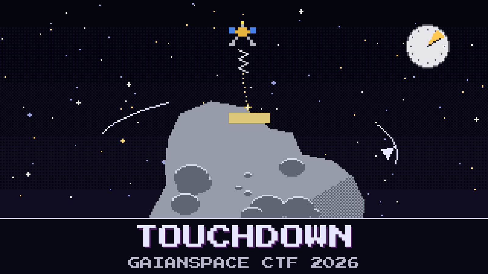

# 113-touchdown

> AO-111 is holding station 500 m above `2041 QM23`. The lander has one spring, one shot, and no radio that can hear Earth.

The rock is light-minutes away, so nobody gets to steer. Everything the lander needs has to be on the order before it lets go: which spring, and which release slot. After that it falls, slowly, onto a spinning metal rock in almost no gravity. If it comes in too fast it bounces back into space. If it comes in at the wrong moment it lands on plain rock and the trip was for nothing.

The hover camera has watched the rock turn for two days. Kaito says the period is obvious. Sunniva wants the order checked twice.

Write the order.

**Flag format:** `GAIANSPACE{<spring>-<slot as four digits>}` — for example `GAIANSPACE{B-0042}`.

## Files

- `hover_photometry.csv` — the hover camera's brightness record of the rock, UTC
- `descent_card.md` — the rock, the hover station, the lander, and the release slots

---

*The PGM Rush is inspired by AstroForge, whose unusually open mission updates show how cheap, autonomous deep-space spacecraft could open the solar system not only to asteroid mining but to faster, cheaper science for everyone.*

## Hints

- **Two faces** (cost 40): An elongated rock shows you its broad side twice every turn. The two views are not quite the same.
- **Slow fall** (cost 60): The lander is not moving at the speed the spring gave it for most of the way down. And the rock keeps turning while it falls.
