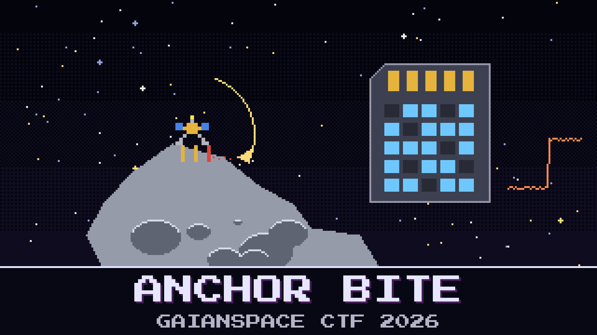

# 114-anchor-bite

> 03:07 UTC on 6 November 2041. AO-111's lander has hopped to its second site on `2041 QM23` and fired its three foot anchors. Then the link dropped, and the deck log was gone by morning.

At the second site the arm has to put XRF-9 on a metal vein no wider than a hand. The arm's target table was loaded for the lander's heading before anchoring. If one foot didn't bite, the lander turned on the other two, the table is wrong, and the arm puts a quarter-million-dollar instrument on bare rock. The sun sensor was parked for the anchoring, so the only record of how the deck moved is the deck recorder's IMU log.

That log no longer exists. The recorder closes each session by queueing a summary and then rotating its files. The link to the mothership dropped before the summary went out, and housekeeping deleted the log anyway. Overnight the mothership pulled a raw image of the recorder's SD card over the trickle link.

Kaito has already picked his anchor. The pyro team's rule says a foot that bites gives a hard spike at the deck, and one of the three spikes is soft. Sunniva wants the actual turn before anyone touches the arm.

Which anchor slipped, and how far did the lander turn?

**Flag format:** `GAIANSPACE{<anchor letter>-<heading change in whole degrees, clockwise as seen from above>}` — for example `GAIANSPACE{C-5}`. It is the turn from rest before that anchor fired to rest after it. A turn the other way is negative, for example `GAIANSPACE{C--5}`.

## Files

- `dkr2_sd.img.gz` — raw image of the deck recorder's microSD card, as pulled overnight
- `lander_events.log` — the lander OBC's event log around the anchoring
- `dkr2_manual.md` — the deck recorder's manual
- `anchor_ops.md` — the anchoring procedure and the pyro team's notes

---

*The PGM Rush is inspired by AstroForge, whose unusually open mission updates show how cheap, autonomous deep-space spacecraft could open the solar system not only to asteroid mining but to faster, cheaper science for everyone.*

## Hints

- **Two writers** (cost 40): The recorder wrote two files at once. When one of them is deleted, the card still knows where it began and how long it was, but not which pieces were its own.
- **Ask the chip** (cost 60): Paper says how the sensor was meant to be set. At the top of its own log, the sensor said how it really was set.
