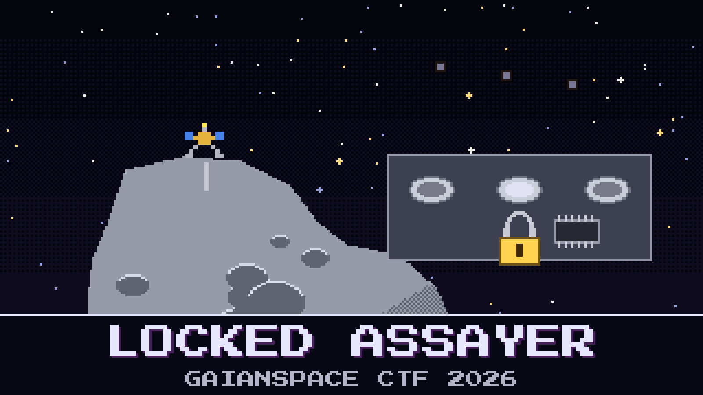

# 115-locked-assayer

> AO-111 is down on `2041 QM23` and the assayer has already run three cups. The answer is sitting in the lander, and the company that built the assayer won't let anyone read it.

AsterOre leased the XRF assayer from Orlik Instruments and paid for it in four instalments. Finance held back the last one until the rock proved itself. Overnight Orlik suspended the licence from Brno. The analyser still measures and still keeps every result, but each result leaves the unit sealed, and the seal now needs a seed that Orlik pulled back. Finance will pay once Sunniva signs the ore contract, and Sunniva won't sign without the grade under the anchor.

The lander OBC pulled the assayer's whole controller flash over the debug link, and the mothership logged the lander's beacons all morning. Kaito says the seal is military-grade and the only way in is a cheque.

Sunniva wants the anchor-site result, and its certificate code is the proof that it came off the instrument.

**Flag format:** `GAIANSPACE{<certificate code, exactly as the assayer prints it>}` — for example `GAIANSPACE{XR9-AAAAAA}`.

## Files

- `xrf9_flash.bin` — the assayer controller's whole flash, 4 MiB, read over the lander's debug link
- `lander_link.log` — the mothership's log of the lander's housekeeping beacons
- `lander_icd.md` — the beacon layout and a note on the assayer
- `orlik_notice.md` — Orlik's suspension notice

---

*The PGM Rush is inspired by AstroForge, whose unusually open mission updates show how cheap, autonomous deep-space spacecraft could open the solar system not only to asteroid mining but to faster, cheaper science for everyone.*

## Hints

- **Nothing was deleted** (cost 40): Orlik changed what the unit holds. A flash chip only clears old data when it needs the room.
- **Same name, other way round** (cost 60): The seal is tied to the unit. The unit and the bus don't write its name in the same order.
