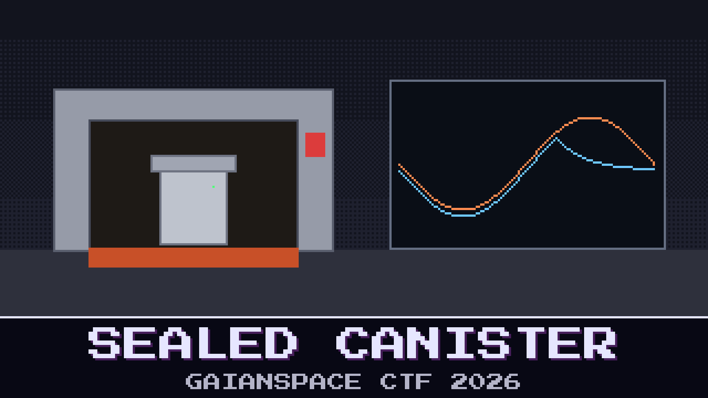

# 116-sealed-canister

> Kaito says aliens. Sunniva says gloves. The answer is in a canister that left Earth eight months ago.

AO-111's little lab keeps its samples in a sealed cell. The cell was filled with dry nitrogen in the clean room, closed, and sent through one last thermal test before it was packed for launch, with its own logger inside. The test house stamped it PASS. If the seal opened in that chamber, clean-room air got in, and the molecule from the moonlet could be nothing more than somebody's fingerprint.

Sunniva has found a pressure drop during the hot soak and says that is where the gloves got in. Kaito says that drop is just the O-ring settling and the seal never opened at all. They have agreed on one thing: whoever is wrong buys dinner, and the logger decides.

Did the seal open, and when?

**Flag format:** `GAIANSPACE{<record number, as in the rec column, of the first record taken after the seal opened>}` — for example `GAIANSPACE{1234}`.

## Files

- `cl3_0419_env.csv` — the cell logger's raw environment records, one per second
- `cl3_0419_co2.csv` — the logger's CO2 sensor, every five seconds
- `cl3_0419_boot.txt` — what the logger printed when it started
- `cl3_datasheet.md` — the logger's datasheet
- `tvac_report.md` — the test house's report for the run

---

*The PGM Rush is inspired by AstroForge, whose unusually open mission updates show how cheap, autonomous deep-space spacecraft could open the solar system not only to asteroid mining but to faster, cheaper science for everyone.*

## Hints

- **One number** (cost 40): A closed box of gas keeps one number fixed while it warms and cools. Find where it stops being fixed for good, not just for a moment.
- **Shape or seal** (cost 60): A box can change its shape without opening. After a step, ask whether the gas still obeys the same law.
