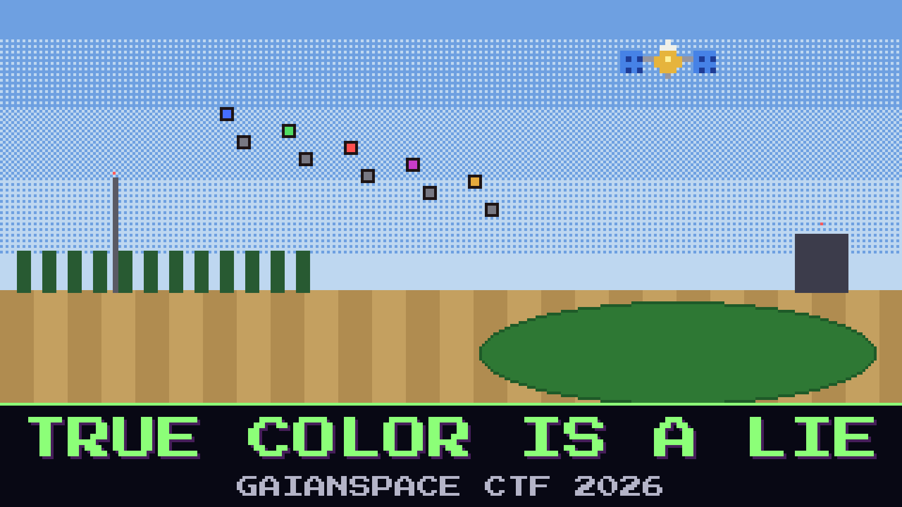

# 122-true-color-is-a-lie

> 06:55. The second pass. This time the tractors took the map, and the spreaders are already rolling.

The new tile looks perfect on the tablet: the lagoons by the treatment works, the stubble, the edge of the pivots. But the lead Johnripper has marked every green thing on the tile as dead and is spreading at its maximum rate. Babb walked the pivots an hour ago. The corn isn't dead.

After the first pass, the co-op lent the farm a cheap SDR, and it has been sitting next to the mast since then, keeping every burst it hears on the AgriLink frequency. AgriLink says this pass was one transmission. The SDR doesn't agree.

There's more. Since last night AgriLink sends the channels without names, "to save airtime", and the mast puts them in order from its band-order file. Someone rewrote that file at 02:13 from a remote session nobody at the farm remembers opening.

Find out what AgriLink really sent.

**Flag format:** `GAIANSPACE{...}`

## Files

- `coop_sdr_0655.sigmf-data` — the co-op SDR's bursts from the pass (too large to attach: download it from [Hugging Face](https://huggingface.co/datasets/GaianSpace/ctf-2026-120/tree/main/122))
- `coop_sdr_0655.sigmf-meta` — the SDR's metadata for that file
- `band_order.conf` — the mast's band-order file, as it is now
- `tablet_0655.png` — what the tablet showed

Contains modified Copernicus Sentinel data 2025.

## Hints

- **Same song, two throats** (cost 30): Every word in this pass that matters was said twice, and the two speakers are not quite in tune with each other.
- **The field knows its colours** (cost 50): Water, bare soil and green leaves each answer the light their own way. Order the channels by what the farm shows you, not by what the file says.
