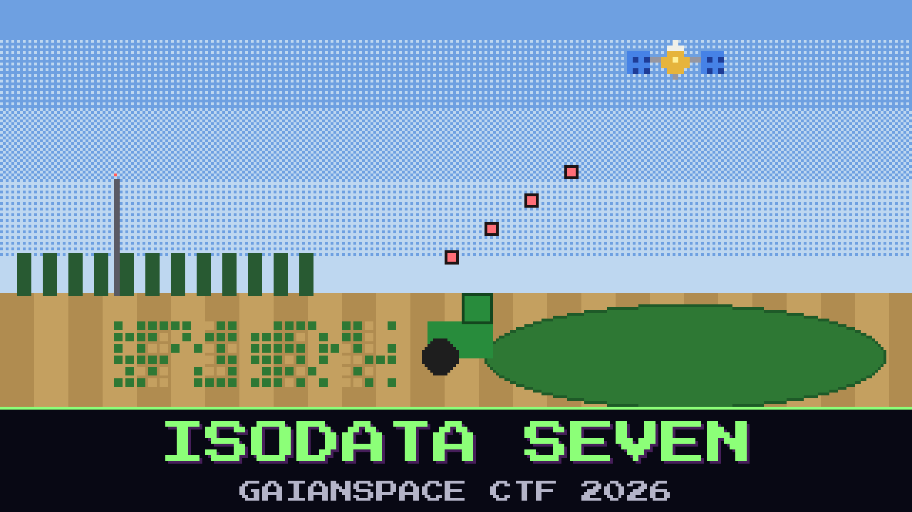

# 123-isodata-seven

> 09:30. Babb has pulled the fleet back to the yard. The tractors stopped listening to the mast at dawn. They've been listening to someone else.

The Johnripper terminals take their maps over their own radio, on the dealer's private settings. The dealer won't share them: *proprietary, see your service contract.* All Babb has is two pages of the service manual that someone at the co-op photocopied years ago. The page in between is missing.

The co-op SDR was moved to the tractor shed this morning, and it heard that channel too. Whatever the stranger sent the tractors wasn't a fertiliser map. It was a full tile of the farm, every channel, and it looks just like the real thing, except for one patch of the north field that Babb can't explain.

Babb's notes from the county's remote-sensing course are still in the cab door pocket. In the margin, underlined twice: *count what actually grows here.*

Find what the stranger planted in the tractors' tile.

**Flag format:** `GAIANSPACE{...}`

## Files

- `shed_sdr_0930.sigmf-data` — the co-op SDR's bursts on the tractor channel (too large to attach: download it from [Hugging Face](https://huggingface.co/datasets/GaianSpace/ctf-2026-120/tree/main/123))
- `shed_sdr_0930.sigmf-meta` — the SDR's metadata for that file
- `jr_manual_p14_p16.txt` — the photocopied pages of the Johnripper service manual
- `course_notes.txt` — Babb's notes from the remote-sensing course

Contains modified Copernicus Sentinel data 2025.

## Hints

- **No band gives it away** (cost 30): Look at any one channel of the stranger's tile, or at any picture made from the usual three, and the patch is only noise. That was the point.
- **As many as the course** (cost 50): Babb's course always asked the tile for a fixed number of kinds of ground. The stranger counted on nobody asking.
